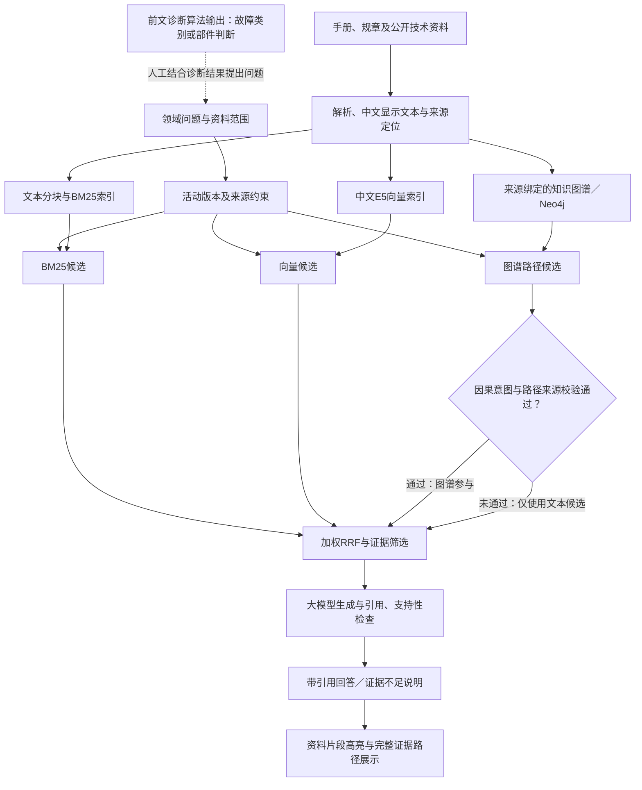
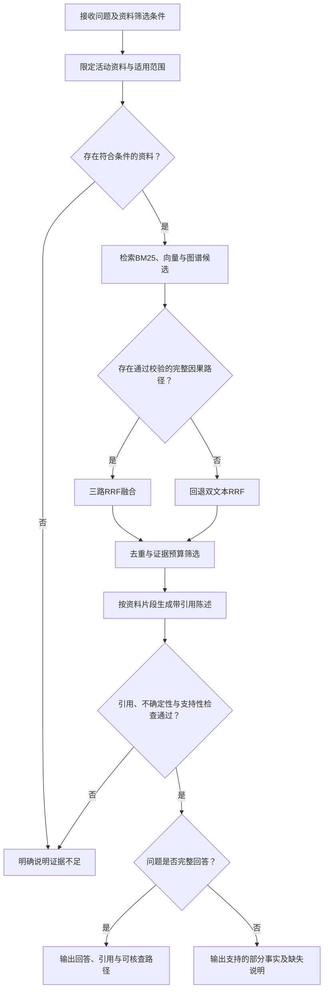
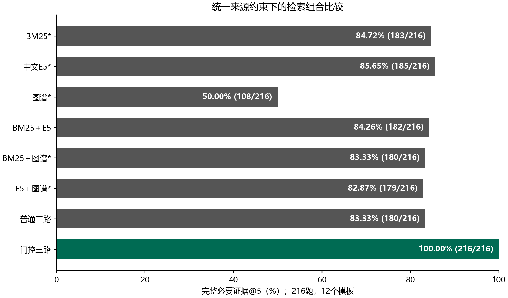
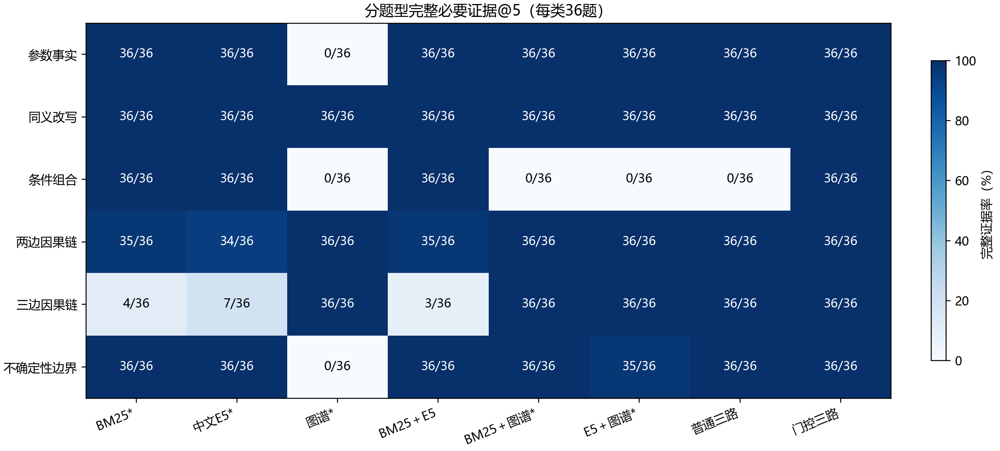
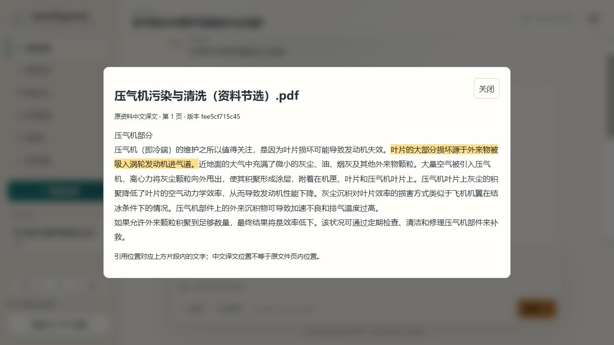

# 第五章 面向航空发动机故障诊断的知识增强问答方法

本文件为章节组织与5.1正文初稿。章节编号按第五章组织，字体、图表题位置、公式格式、参考文献著录等在排版阶段服从学校学位论文模板。前文章节的具体模型名称和输出形式尚未核对，以下不作假设。

## 一 章节组织

| 节次 | 建议标题 | 主要内容与论证作用 |
|---|---|---|
| 5.1 | 引言 | 承接诊断算法：故障判断之后仍需查询机理、排查依据与适用条件；界定本章知识增强的任务与边界 |
| 5.2 | 知识增强问答总体框架 | 问题与输入输出定义；离线知识组织和在线问答；算法结果与本章之间的使用关系；总体架构图 |
| 5.3 | 领域知识组织与来源关联 | 文档解析与中文显示、证据分块和版本定位；实体关系模式、来源绑定及Neo4j存储；区分实际资料图谱与规则构造实验图谱 |
| 5.4 | 门控混合检索与证据约束回答 | 来源约束、BM25与E5、图谱多跳路径、门控规则、加权RRF、去重与预算、片段引用和不足处理；作为方法重点 |
| 5.5 | 实验结果与分析 | 数据和指标、单/双/三路比较、分题型结果、消融、真实资料案例、功能验收和局限 |
| 5.6 | 本章小结 | 归纳知识增强补充了哪些能力、在何种条件下有效，不重复堆列所有指标 |

### 建议三级标题

5.2.1 任务定义与输入输出；5.2.2 总体架构与工作流程。

5.3.1 文档处理与证据单元构建；5.3.2 图谱模式与来源绑定；5.3.3 知识索引与版本维护。

5.4.1 来源约束的文本混合检索；5.4.2 有向多跳路径检索；5.4.3 路径可信度门控与融合排序；5.4.4 证据约束回答与引用校验。

5.5.1 实验数据与设置；5.5.2 评价指标；5.5.3 检索组合对比；5.5.4 分题型与消融分析；5.5.5 实际资料问答案例与系统验收；5.5.6 局限性分析。后续新增的独立端到端回答质量实验应独立成节，不将工程验收改称准确率实验。

## 二 5.1 引言正文初稿

前文围绕航空发动机故障诊断算法开展研究，通过对运行数据中故障相关特征的分析，为故障识别提供了方法支持。然而，在实际诊断过程中，获得故障类别或相关部件的判断并不意味着诊断任务已经结束。针对诊断结果，使用者通常仍需进一步查阅技术资料，了解相关异常的形成机理、可能涉及的部件及后续检查依据，并判断这些知识是否适用于当前问题。因此，如何将数据驱动的故障判断与领域知识的查询和解释相结合，是完善故障诊断支持能力需要考虑的问题。

航空发动机相关知识通常分散于技术手册、规章和公开技术资料之中。其中，部分问题可以通过单个资料片段回答，而涉及故障机理或关联关系的问题，可能需要联合多个片段中的证据。例如，对某一异常现象的解释，可能需要同时获得上游影响因素、中间作用环节及下游表现等信息。仅依据问题与文本的相似度进行检索，未必能够同时保留这些必要证据；另一方面，无差别引入图谱关系也可能干扰与问题直接相关的文本证据。因此，需要结合问题特点，研究文本证据与关系知识的组织和使用方式。

大语言模型能够以自然语言组织检索结果，为领域知识交互提供了一种实现途径，但其生成内容仍需受到外部证据约束。尤其对于故障机理、适用条件和不确定原因等问题，若缺少来源约束，可能将相关性描述误写为确定因果关系，或在证据不完整时给出超出资料范围的结论。为此，本章将“知识增强”具体落实为领域资料对检索过程和回答过程的约束：以可定位的资料片段提供事实依据，以来源绑定的知识图谱组织显式关系，并在回答中保留引用及证据不足说明。

基于上述考虑，本章面向航空发动机故障诊断中的知识查询与解释需求，构建知识增强问答方法。在离线阶段，对领域资料进行解析和证据组织，建立文本索引、向量索引及来源关联图谱；在在线阶段，采用来源约束下的文本混合检索，并根据问题的因果意图与图谱路径的来源校验结果，决定是否引入图谱候选参与融合排序。在此基础上，通过片段级引用与回答检查，使生成内容能够回溯至相应资料，并在现有证据不足以回答问题时明确指出缺失。

本章与前文诊断算法之间形成任务上的衔接：前文侧重利用数据获得故障判断，本章侧重围绕诊断相关问题提供可核查的领域知识支持。诊断结果可以作为使用者提出后续问题的背景，但本章不以提高前文分类模型的识别准确率为目标，也不将资料中的因果路径直接等同于对当前发动机故障原因的确认。后续将通过检索组合对比、分题型评价和消融实验分析所提方法的适用条件，并结合实际资料问答案例验证系统功能。

## 三 研究贡献的表述边界

可归纳为两个方法设计点和一个实现结果：

1. 来源约束下的条件化图谱参与机制：联合问题因果意图与有向路径来源校验，按需启用三路融合，不适用时回退文本。
2. 面向多证据问题的来源绑定与回答约束：将路径关联至资料片段，保留片段引用、不确定性与不足说明，支持使用者核查。
3. 构建可运行的领域知识问答系统，并通过统一预算下的组合、分型和消融实验分析方法适用性。

这些是本章的设计贡献候选。正式称为相对现有工作的创新，需要补齐相关研究比较。文档解析、Neo4j存储、BM25、E5和RRF均为采用的成熟技术，不单独包装为原创算法；不使用“首次”“通用自主诊断”等未经论证的表述。

## 四 图表与实验安排

图5-1为总体架构；图5-2为在线问答流程；图5-3建议展示来源片段—实体—关系—引用的对应示例；图5-4为统一来源约束下的组合比较；图5-5为分题型完整证据率；图5-6为带引用回答与原文定位案例。截图只用于说明交互与可核查性，不替代定量评价。

表5-1列出实体和关系模式及实际样例；表5-2列出数据规模、来源和划分；表5-3列出检索预算及参数；表5-4为单/双/三路总体指标；表5-5为分题型指标；表5-6为门控、单边/路径及路径插入消融；表5-7可列工程验收。后续独立回答质量结果另表列出，当前不填造数值。

### 已有主要检索结果（统一来源约束）

完整证据@5指前5条结果同时包含题目全部必要证据，不是回答准确率。以下均为同一批216道程序化构造自建场景题。带*配置为测试可见后的固定权重补充消融，未分别重新优化。

| 方法 | 完整证据@5 | nDCG@5 | MRR |
|---|---:|---:|---:|
| BM25* | 183/216 | 0.8926 | 0.8912 |
| 中文E5* | 185/216 | 0.9019 | 0.9124 |
| 图谱* | 108/216 | 0.4983 | 0.4977 |
| BM25＋E5 | 182/216 | 0.8947 | 0.8958 |
| BM25＋图谱* | 180/216 | 0.6492 | 0.5792 |
| E5＋图谱* | 179/216 | 0.6648 | 0.5991 |
| 普通三路 | 180/216 | 0.6532 | 0.5843 |
| 门控三路 | 216/216 | 0.9843 | 0.9838 |

门控三路相对双文本改善34题、退化0题，集中于1道两边链和33道三边链；相对匹配权重普通三路的36题改善均来自条件组合题回退。应分别解释多跳补证与避免干扰，不将全部收益归于图谱推理。单路E5高于双文本的结果也需保留。

## 五 正式写作前需解决的问题

* 核对前文章节：需依据实际算法输出、验证数据与术语修改5.1首段，不能假定已有算法输出与问答的自动联动。图中以虚线表示人工结合诊断结果提问。
* 本章需补齐直接支撑方法选择的相关研究和文献引用；目前引言为不含文献编号的正文初稿，不虚构参考文献。
* 自建场景须披露AI辅助模板与程序化构造方式，区分真实资料实验。规则编译图谱不能用来证明自动抽取质量；新旧共享构造语法的限制应说明。
* 已有参数在测试前冻结，但最终门控方案在观察v2结果后选定。补充组合属于描述性消融，不写成预登记确认实验。
* 现有4例实际资料问答是工程验收，69项测试是软件回归，均不能替代独立回答质量实验。需要后续固定未见问题、审核答案与引用，并记录成本与时延。
* 定义多跳能力为“来源支持的有向关系路径检索与证据组合”，不写成自主确认真实故障根因，不宣称改善前文诊断准确率。

## 六 架构与流程图草稿

图5-1：总体架构。虚线为任务上的衔接，尚不表示诊断算法已自动调用知识问答；各成熟技术作为实现组成部分。

图5-2：在线检索与回答流程。图谱门控和回答充分性检查是两个不同环节。

已有实验图：

已有系统截图：

对应完整实验分析见 `../reports/gated-triple-paper-2026-10-16/THESIS-EXPERIMENT-ANALYSIS.md`；运行验收见 `../reports/LIVE-GATED-QA-INTEGRATION-2026-10-16.md`。
