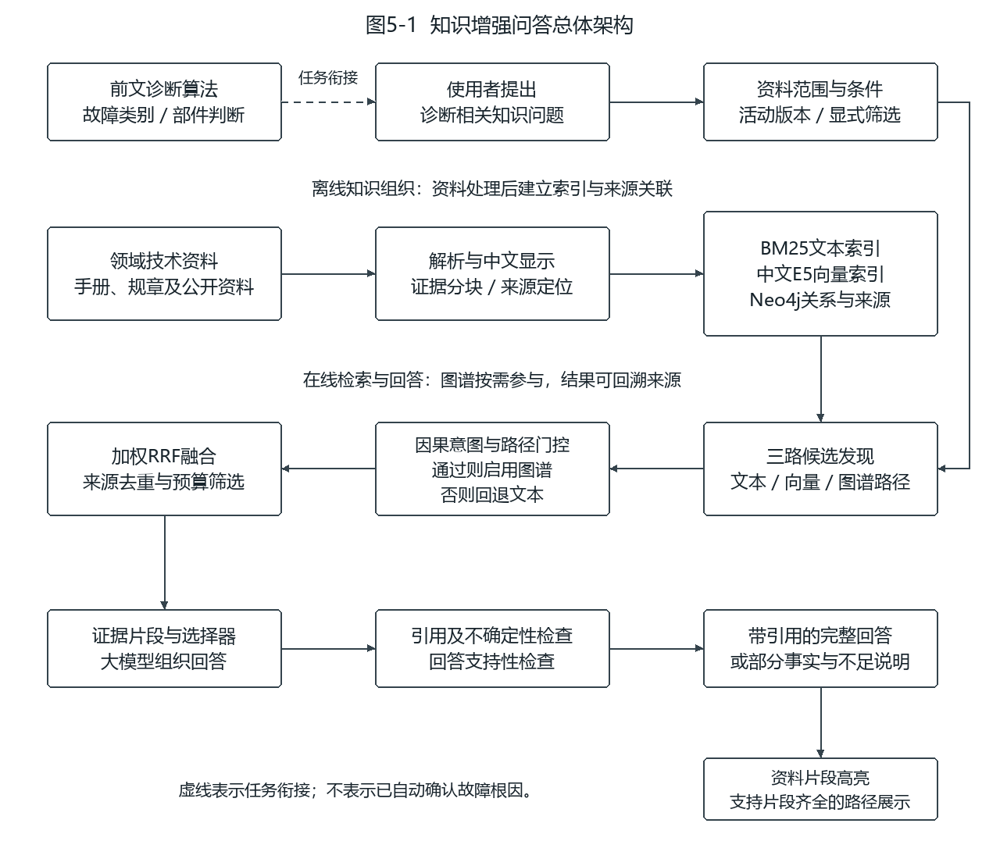
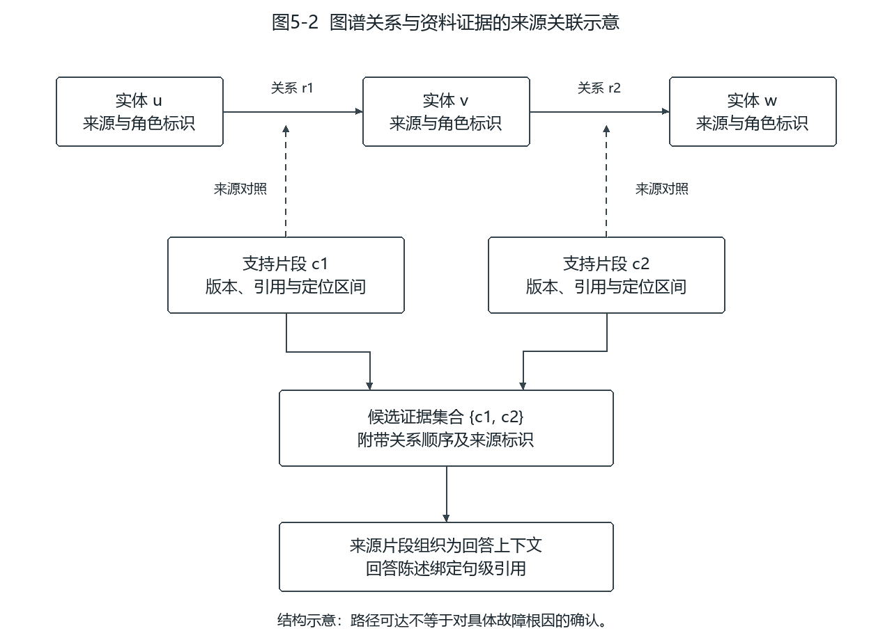
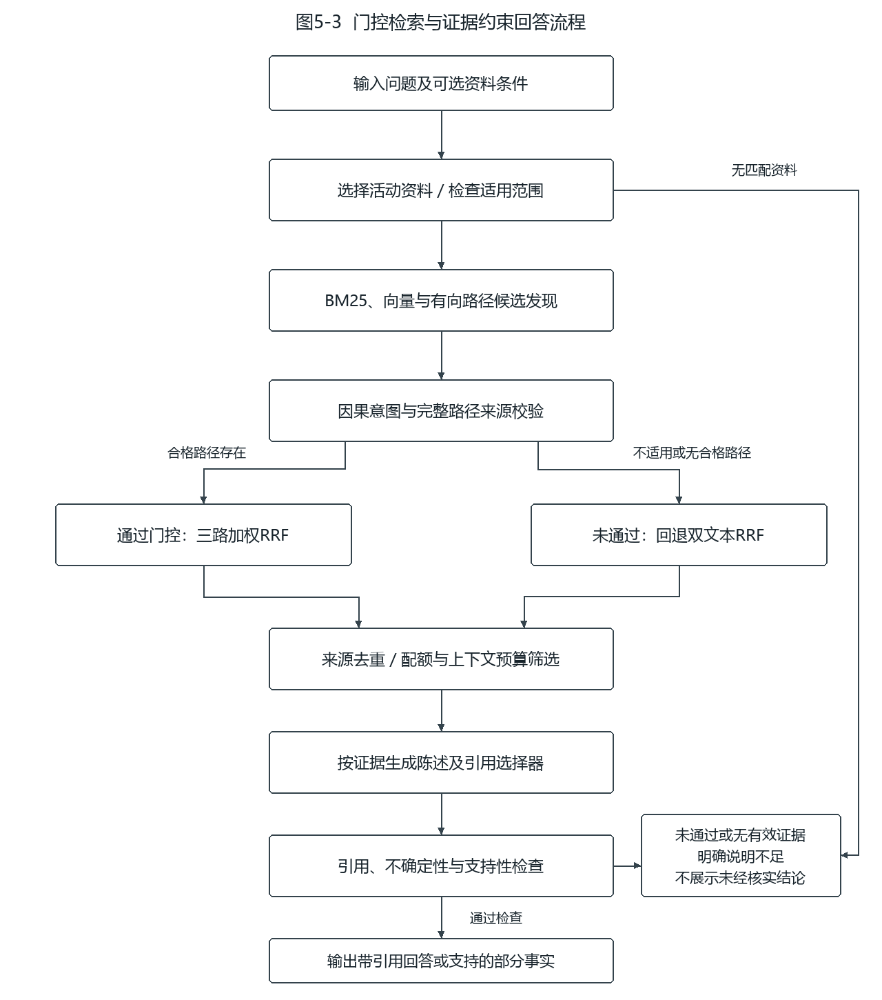

# 第五章 面向航空发动机故障诊断的知识增强问答方法

## 5.2 知识增强问答总体框架

### 5.2.1 任务定义与输入输出

前文故障诊断算法主要根据运行数据中的特征形成故障判断。在获得诊断结果后，使用者仍可能需要查询相关机理、适用条件和检查依据。本章面向这一后续知识需求，将诊断相关知识问答定义为：在给定领域资料及其适用范围的条件下，检索与问题相关的证据，并据此形成能够回溯至资料来源的自然语言回答。

设领域资料集合为 \(\mathcal{D}\)，由资料解析得到的证据片段集合为 \(\mathcal{C}\)，来源关联图谱为 \(\mathcal{G}\)。用户输入由问题 \(q\) 和可选筛选条件 \(\xi\) 组成，其中 \(\xi\) 可以包括指定文档、发动机型号、飞行阶段或来源修订信息。问答过程表示为

\[
(\mathcal{E}_q,\mathcal{P}_q,A_q,z_q)=F(q,\xi;\mathcal{C},\mathcal{G}), \tag{5-1}
\]

其中，\(\mathcal{E}_q\) 为检索得到的证据片段，\(\mathcal{P}_q\) 为满足来源校验和展示条件的路径，\(A_q\) 为带引用的回答，\(z_q\) 表示当前证据是否足以支持完整回答。当证据不充分时，系统输出缺失说明，并可以保留已经获得支持的部分事实。

上述定义将知识增强的作用限定在三个方面：通过领域资料补充模型回答所需的事实依据，通过图谱关系组织分散的关联证据，以及通过来源引用和不确定性检查约束回答内容。其中，诊断算法输出可以作为使用者组织问题的背景。例如，使用者可以围绕已获得的部件判断，查询相关异常的作用机理或检查依据。本章实现采用自然语言问题作为问答入口，前文诊断模型与问答模块之间的衔接体现在任务层面，尚不将模型输出直接作为自动确认故障根因的条件。

对于多跳问题，本章关注的是沿资料明确陈述的有向关系发现路径，并检索支持各关系的原始证据。即使存在 \(u\rightarrow v\rightarrow w\) 的关系链，也需要考虑各关系所处的来源、条件和确定性，不能仅依据图上的可达性确认某一具体发动机的故障原因。因此，路径结果用于提供可检查的知识关联，而不作为现场诊断结论的替代。

### 5.2.2 总体架构与工作流程

总体框架包括离线知识组织与在线检索回答两个阶段，如图5-1所示。离线阶段对领域资料进行解析，保留文本结构及来源位置，构建文本索引、向量索引和来源关联图谱；在线阶段根据用户问题选择活动资料，联合文本检索与图谱候选发现，经门控和融合排序形成回答上下文，再生成并检查回答。

图5-1中，文本索引和向量索引均以资料片段为检索对象。两者分别从词项匹配和语义匹配角度提供候选证据。图谱保存实体、关系及其来源关联，并将检索到的关系路径映射回对应资料片段。由此，三路检索可以在共同的证据标识上进行融合，避免将缺少来源的关系标签直接视为回答依据。

在线阶段首先确定资料范围。在此基础上，BM25和向量检索提供文本候选，图谱检索提供关系关联的候选片段。系统根据问题的因果意图以及是否存在通过来源校验的完整路径，决定图谱候选是否参与融合。若条件满足，则执行三路加权排序；若不满足，则回退文本检索。该过程不要求每个问题都使用图谱，从而保留文本检索对事实查询和条件查询的覆盖能力。

融合后得到的片段进一步经过来源去重、文档配额和上下文预算筛选。回答模块依据实际进入上下文的片段组织陈述，并为每项陈述附加来源选择器。随后执行引用定位、不确定性和回答支持性检查，输出带引用的回答或证据不足说明。用户能够从回答进入来源片段，核对引用内容及位置；对于支持证据齐全的路径，还可以逐条查看其关系依据。

离线资料更新与在线问答相互分离。新增资料或修订版本在处理后进入检索范围，查询期间使用活动版本约束，避免已被替代的内容继续作为当前依据。该设计使资料维护能够独立于每次提问完成，同时为回答与来源的一致性检查提供条件。

## 5.3 领域知识组织与来源关联

### 5.3.1 文档处理与证据单元构建

领域资料的文件格式和表达形式存在差异。PDF、Word、HTML及结构化表格中的知识，需要先转换为具有来源信息的文本表示。本章复用现有文档解析组件，提取段落、标题和表格等结构，并保留能够获得的页码、文本区间和文件版本信息。解析结果既用于文本检索，也作为图谱关系来源校验的基础。

设第 \(i\) 个证据片段表示为

\[
c_i=(\mathrm{id}_i,d_i,v_i,t_i,\widetilde t_i,\ell_i,m_i), \tag{5-2}
\]

其中，\(d_i\) 和 \(v_i\) 分别表示文档及版本标识，\(t_i\) 为来源文本，\(\widetilde t_i\) 为用于中文检索和显示的文本，\(\ell_i\) 为来源定位信息，\(m_i\) 为适用范围等元数据。中文资料可以直接采用来源文本；英文资料在获得中文译文后，通过来源文本的哈希记录译文所对应的版本。若译文记录与来源版本不一致，则不将其作为已验证的中文显示文本使用。哈希检查用于发现内容版本错配，本身并不验证翻译语义是否准确。

证据划分兼顾检索粒度与来源上下文。片段过长时，问题相关信息容易被其他内容稀释；片段过短时，条件、否定或适用范围可能与主陈述分离。因此，资料组织采用结构化分段和分层证据记录，在可获得的标题、段落和表格边界附近构建检索片段，并保留与较完整上下文之间的关联。后续问答以实际检索到的片段为基础，不将整个文档默认视为已经进入生成上下文。

来源文本和中文显示文本具有不同的定位空间。原文件页码和解析区间用于回溯资料；回答引用的字符偏移则对应实际提供给模型的显示文本。对于译文，不能直接将显示文本偏移解释为英文原文件页内坐标。系统在原文查看界面显示资料名称、版本与可获得的页码，并在中文片段内高亮引用内容，以保持引用范围明确。

### 5.3.2 图谱模式与来源绑定

为组织与诊断相关的显式知识，图谱采用属性图表示

\[
\mathcal{G}=(\mathcal{V},\mathcal{R},\mathcal{A}), \tag{5-3}
\]

其中，\(\mathcal{V}\) 为实体集合，\(\mathcal{R}\) 为有向关系集合，\(\mathcal{A}\) 为实体和关系的属性集合。模式围绕发动机、部件、症状、原因、作用机理、参数、检查、处置及条件等知识对象设置。类型的作用在于区分对象角色和关系用途，而不追求覆盖航空发动机领域的完整本体。

表5-1 主要知识对象及其组织用途

| 对象或关系 | 表示内容 | 在本章中的用途 |
|---|---|---|
| 发动机、部件 | 诊断对象及其组成部分 | 确定知识涉及的对象与范围 |
| 症状、参数 | 异常表现与可观测量 | 关联问题中的现象和技术量 |
| 原因、作用机理 | 来源陈述的影响因素及作用环节 | 构建有向关联路径 |
| 检查、处置 | 检查手段与来源给出的行动建议 | 支持检查依据和维修知识查询 |
| 条件 | 来源明示的适用前提 | 限定关系与回答的适用范围 |
| 导致、促成 | 明确因果或贡献关系 | 作为受约束因果路径的关系类型 |
| 指示、检查方式、缓解措施等 | 指标含义及非因果关联 | 保留相关知识，不统一解释为因果关系 |

关系记录除头实体、关系类型和尾实体外，还保存来源文档、版本、支持片段、引用文本、定位区间、极性、确定性及条件信息。设一条来源关系记录为

\[
r_j=(u_j,p_j,w_j;d_j,v_j,S_j,\eta_j), \tag{5-4}
\]

其中，\(S_j\) 为支持该关系的一个或多个资料片段，\(\eta_j\) 为确定性、极性和适用条件等属性。通过该表示，图谱关系能够回溯到资料中的具体表述，而不只保留脱离上下文的三元组。图5-2给出了关系、证据与回答引用之间的对应关系。

实体连接采用保守的来源约束。只有在实体提及具备有效来源定位、角色和类型一致，并且处于相同文档与版本范围时，才依据来源中经既定术语规范化后相同的表述建立连接。仅有名称相似或翻译相近不足以合并实体；无法完成连接校验的对象保留为独立提及。该处理有助于减少同名对象、不同条件或不同来源之间的误连，但也会限制可检索路径的数量。

图谱构建使用基于来源片段的抽取与校验流程，对未通过来源定位或关系属性检查的候选进行修订或排除。图谱中的“导致”“指示”和“建议检查”等关系分别保留原有语义，不将一般关联转换为确定因果。对多跳检索，进一步限定可参与门控的关系类别和确定性，以防止将若干相关片段连接后解释为资料未陈述的故障结论。

实际资料知识库与自建场景实验采用不同的数据构建条件。实际资料图谱包含抽取和来源复核环节；自建场景实验的关系则由明确设定的因果记录子集编译，用于检验检索和融合机制。这两类图谱的结果应分别解释，规则构造图谱的检索表现不能直接作为实际资料自动抽取质量的评价。

### 5.3.3 知识索引与版本维护

文本片段采用BM25索引与中文语义向量索引并行组织，图谱采用Neo4j保存实体和关系属性。文档、版本和片段标识贯穿三种表示，使检索结果能够回到同一来源记录。图谱检索最终返回的也是支持关系的资料片段，从而能够与文本通道按片段标识合并。

资料更新以版本为单位管理。对于同一逻辑文档，修订内容形成新的版本，经解析和索引处理后再切换为活动版本，旧版本保留历史身份，但不继续参与面向当前资料的问答。来源条件不明确时保留未知状态，不根据缺失信息推断资料对某型号或飞行阶段通用。

在线查询先根据活动版本及用户指定的资料条件确定范围。若用户显式指定的资料或编号没有对应记录，则返回无匹配证据，而不自动扩大到其他来源。对于存在明确适用条件的资料和关系，检查其与问题条件是否冲突；严格筛选模式进一步排除无法确认适用性的证据。对于缺少充分条件信息的片段，其适用状态随证据传递到回答阶段。

为避免生成期间发生版本变化，回答返回前再次检查来源可见性和显示文本哈希；若资料已被替代或文本发生变化，则要求重新检索。来源查看接口同样校验活动版本，使用户看到的片段与当前有效资料相对应。该机制用于维护检索、生成和查看环节的一致性，而不替代资料内容本身的专业审核。

## 5.4 门控混合检索与证据约束回答

### 5.4.1 来源约束的文本混合检索

词项检索和向量检索对问题表述具有不同的响应特点。BM25依据词项匹配提供候选，便于保留问题中的技术术语和明确标识；向量检索通过问题与片段的语义表示计算相似度，补充表述差异较大的相关内容。本章将两者作为文本检索基础，并在检索前统一限定来源范围。

令 \(\Omega(q,\xi)\) 为符合活动版本及查询条件的资料集合，则文本候选表示为

\[
\mathcal{C}_B=\operatorname{Top}_{n_B}\{s_B(q,c):c\in\Omega(q,\xi)\},\qquad
\mathcal{C}_D=\operatorname{Top}_{n_D}\{s_D(q,c):c\in\Omega(q,\xi)\}. \tag{5-5}
\]

其中，\(s_B\) 为BM25排序得分，\(s_D\) 为语义相似度。词项索引针对英文标识及中文文本保留相应词项表示，中文向量通道采用本地多语言E5模型，分别编码问题和片段，并使用余弦相似度进行排序：

\[
s_D(q,c)=\frac{\boldsymbol{h}_q^{\mathsf T}\boldsymbol{h}_c}
{\|\boldsymbol{h}_q\|\,\|\boldsymbol{h}_c\|}. \tag{5-6}
\]

对英文来源，语义索引以与来源版本关联的中文显示文本作为输入，减少中文问题直接匹配英文片段时的语言表示差异。该处理并不保证所有跨语言问题均能正确匹配，仍需通过实际资料和问题检验其效果。

来源约束位于各通道检索之前，而不是在全库TopK结果返回后再删除不匹配来源。这样能够避免其他资料占据候选配额后，使指定来源的相关片段无法进入比较范围。对于基于编号的约束，仅识别问题中显式出现、符合既定形式的标识，并在来源文本中进行匹配，不推断缺失编号或未声明的型号关系。

### 5.4.2 有向多跳路径检索

对于涉及多个作用环节的问题，仅返回与起点或终点相似的片段可能不足以解释两者之间的关系。本章在文本检索之外，从来源关联图谱发现有向路径，并检索支持路径各边的资料片段。

路径表示为

\[
P=(u_0\xrightarrow{r_1}u_1\xrightarrow{r_2}\cdots
\xrightarrow{r_L}u_L),\qquad 1\leq L\leq3, \tag{5-7}
\]

其中，\(L\) 为关系边数。候选发现以问题与实体名称之间的词项关联选择起始对象，在有向邻接关系上进行有界遍历，并限制访问次数、分支数和最大路径长度。遍历过程中不重复访问同一路径中的实体身份，以控制循环和无界扩展。候选发现可以包含单边路径，但触发最终图谱参与门控的路径需要具备2—3条有效因果边。

路径候选排序结合实体链与来源文本的匹配程度。记 \(\rho(q,x)\) 为经过既定术语规范化后的词项覆盖得分，\(N(P)\) 为路径实体名称的串联文本，\(T(P)\) 为各边的中文支持片段集合，采用

\[
s_P(q,P)=\frac{0.75\rho(q,N(P))+0.25\max_{t\in T(P)}\rho(q,t)}
{1+0.04(L-1)}. \tag{5-8}
\]

式中，实体链匹配用于衡量路径与问题对象的关联，来源片段匹配用于补充文本信号，分母对较长路径施加轻度折减。该得分只用于候选排序，不表示关系为真的概率，也不是诊断置信度。

设路径所需支持片段的并集为

\[
S(P)=\bigcup_{j=1}^{L}S(r_j). \tag{5-9}
\]

图谱通道将 \(S(P)\) 中的原始片段作为候选返回，同时保留路径的关系顺序、方向、确定性、条件和支持位置。若一条边需要多个来源片段共同支持，则这些片段均计入路径证据，而不只计算其中一条引用。由此，图谱的作用是补充与关系链相关的来源证据，而不是为大模型直接提供一条未经核查的推理结论。

### 5.4.3 路径可信度门控与融合排序

图谱关系覆盖不均，且部分问题不需要因果路径。如果对所有问题无差别加入图谱候选，可能使原本相关的事实或条件证据排序下降。因此，本章设置查询级门控，由问题意图与路径来源校验共同决定图谱是否参与。

令 \(I(q)\) 表示基于规则识别的因果路径查询意图，\(\Pi(q)\) 为发现的路径集合，\(V(P,q,\xi)\) 表示路径校验结果，则门控定义为

\[
g(q,\xi)=I(q)\land\left[\exists P\in\Pi(q):V(P,q,\xi)=1\right]. \tag{5-10}
\]

意图规则关注“因果”“机理”“路径”“中间环节”等表达，并对要求确定归因、反向推断和不确定性边界的问题采用保守回退。该规则是当前实现中的有限表达匹配，不等同于能够覆盖任意语言形式的意图分类模型。

路径校验要求同时满足以下条件：路径由2—3条方向连续的关系构成；关系属于允许的因果类型，具有明确的正向极性及规定的确定性状态；实体与边的来源标识一致，且处于同一来源文档和版本；实体连接和每条关系的引用区间有效；路径两端与问题中的对象满足既定匹配条件；关系适用条件不与查询冲突；支持整条路径的片段均包含在图谱候选配额内。仅有图上连通或名称相近不足以通过校验。

当 \(g=1\) 时，BM25、向量与图谱三路候选共同融合；当 \(g=0\) 时，只保留两路文本候选。图谱不可用或快照无法完成校验时，同样回退文本。门控判断基于问题和实际候选，不读取题型标注、参考答案或必要证据标签。

采用加权倒数排名融合。令 \(\mathcal{H}(q)\) 为实际启用的通道集合，\(r_h(c)\) 为片段 \(c\) 在第 \(h\) 路中的排名，缺失通道不贡献分数，则

\[
s_F(c\mid q)=\frac{\displaystyle\sum_{h\in\mathcal{H}(q)}
\frac{w_h\,\mathbf{1}[c\in\mathcal{C}_h]}{\kappa+r_h(c)}}
{\displaystyle\sum_{h\in\mathcal{H}(q)}\frac{w_h}{\kappa+1}}. \tag{5-11}
\]

分母为通道权重对应的归一化常数，不改变同一次查询的排序。采用排名融合能够避免直接相加BM25得分、余弦相似度与路径得分时的量纲差异。当前配置取 \(\kappa=60\)，三路权重为 \(w_B=1\)、\(w_D=0.25\)、\(w_G=0.25\)。配置选择与评价依据在5.5节说明，不将其解释为对所有资料均适用的最优权重。

表5-2 门控混合检索与上下文组织参数

| 参数 | 当前设置 | 含义 |
|---|---:|---|
| 三路候选上限 | 每路50条 | 总上限150条 |
| 文本回退候选 | BM25 50条、向量50条 | 不将图谱配额重新分配给文本 |
| 融合候选池 | 前50条 | 按融合排序进入证据筛选 |
| 最终证据条数 | 最多10条 | 同时受文档配额和文本预算约束 |
| 每文档证据上限 | 5条 | 避免单一文档占据全部结果 |
| 检索正文预算 | 4096个计数token | 采用本地E5分词器计数 |
| 路径发现长度 | 1—3条边 | 触发门控需2—3条有效因果边 |
| 遍历控制 | 32个起始候选、每次扩展最多24条边、访问预算4000 | 控制搜索规模 |

融合后的证据按得分顺序进行来源去重和预算筛选。去重限于同一文档、同一版本内的相同文本或能够确认被已选片段完整覆盖的锚定内容，不因语义相近而删除独立来源，也不丢弃部分重叠片段中尚未保留的尾部内容。依次加入片段时检查文档配额及文本预算；当前候选超过正文预算时停止该次选择，以保持确定性的有序筛选行为。

门控与路径完整性展示分别处理。设最终证据集合为 \(\mathcal{E}_q\)，则可展示路径集合为

\[
\mathcal{P}_q=\{P:V(P,q,\xi)=1,\ S(P)\subseteq\mathcal{E}_q\}. \tag{5-12}
\]

查询级门控只要求存在一条合格路径后启用图谱通道，不表示对所有入池图谱候选逐项认证，也不保证普通融合排序必然保留每条合格路径。对于未完整进入最终证据的路径，不将其展示为完整依据。最终方案采用门控RRF，而非强制整束插入路径片段，后者作为消融方法在实验中比较。

### 5.4.4 证据约束回答与引用校验

检索结果进入回答阶段后，仍需控制生成内容与来源之间的关系。本章将证据片段切分为可选择的句级区间，为每个区间分配标识，并记录显示文本内的起止偏移和文本哈希。生成模型仅接收问题、片段内容、适用状态及区间选择器，输出由若干陈述组成的回答，同时声明是否存在证据不足及其原因。

设显示文本 \(\widetilde t_i\) 中的引用区间为 \([a_{ij},b_{ij})\)，引用对象表示为

\[
\sigma_{ij}=(\mathrm{id}_{ij},\mathrm{id}_i,a_{ij},b_{ij},
H(\widetilde t_i),\widetilde t_i[a_{ij}:b_{ij}]), \tag{5-13}
\]

其中，\(H\) 为文本哈希函数。模型只能选择已经提供的区间标识，引用文本、偏移和哈希由程序从证据对象中复制。若引用标识不存在、重复或缺失，则不接受相应生成结果。引用位置由此能够与用户查看的片段建立直接对应，而不是依赖模型重新抄写原文。

回答上下文在序列化后再次检查预算，计入问题、来源标识及区间选择器等开销。不能完整装入的片段不提供给生成模型。因此，进入检索结果的证据与实际提供给生成模型的证据可能不同，分别记录为 \(\mathcal{E}_q\) 和 \(\mathcal{E}^{\mathrm{gen}}_q\)。对于图谱路径，进一步记录 \(S(P)\subseteq\mathcal{E}^{\mathrm{gen}}_q\) 是否成立，区分“路径已被检索并可展示”与“路径支持片段已全部提供给模型”。当前生成输入是来源片段及选择器，不将图谱路径直接作为模型已经执行的推理过程。

回答检查分为来源结构检查和模型支持性检查。前者核对引用标识、位置和文本版本，并检查是否将来源中的“可能”“尚不能确定”等表述改写为确定结论；后者使用模型复核陈述与引用之间的支持关系，以及问题要求是否得到覆盖。逐字引用能够证明引用位置有效，但不能单独证明该引用足以支持所写陈述，因而需要将两种检查区分开来。模型复核仍可能遗漏语义问题，其结果不等同于领域专家确认。

若生成结果未通过必要检查，系统不给出未经核实的完整结论，而是提示校验未完成并保留检索证据供查看。若模型明确声明证据不足，可以输出已经得到支持的部分事实，同时说明尚缺少的依据。对于无匹配来源、模型不可用或上下文无法形成等情况，同样返回相应说明，不将单纯检索摘录标记为完整回答。在线处理流程见图5-3。

由上述设计，领域知识在本章中不仅作为生成提示的补充文本，还参与候选来源限定、多跳关联证据发现和回答可核查性约束。文本通道承担一般知识覆盖，图谱在存在合格关系路径时提供结构性补证，引用检查则帮助使用者定位回答依据。这些环节共同构成面向诊断相关知识问题的支持方法，其有效性需结合5.5节的检索实验、分题型分析和实际资料案例进行评价。
