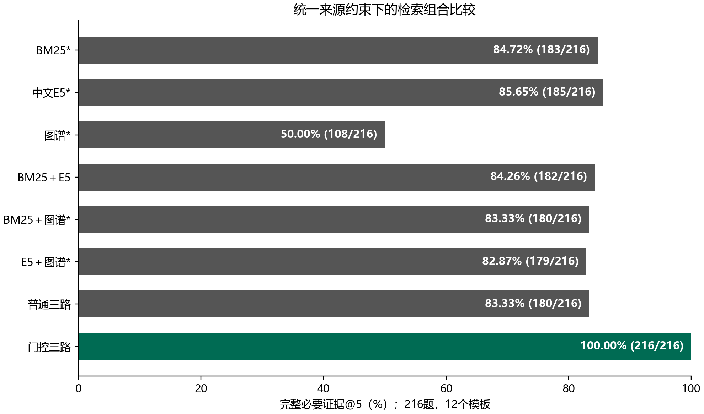
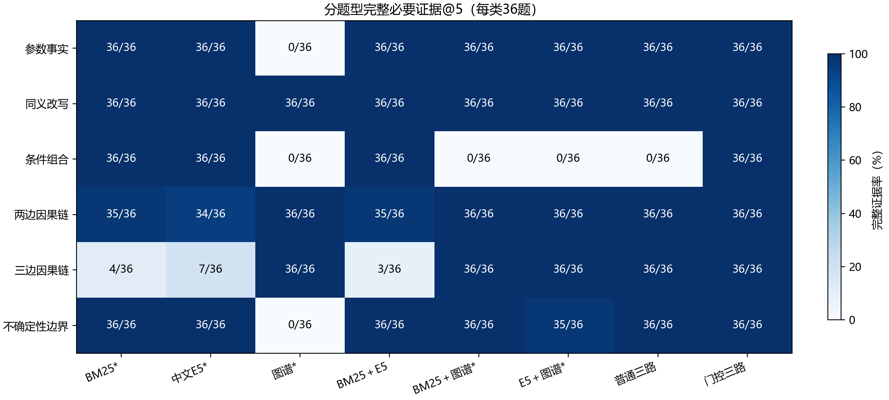
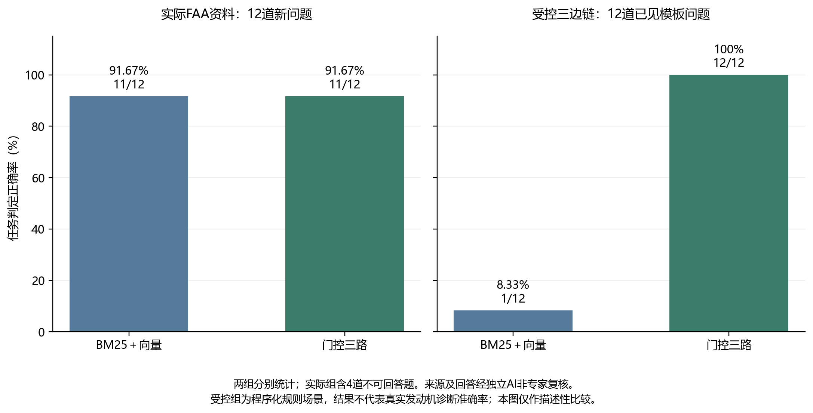

## 5.5 实验结果与分析

### 5.5.1 实验数据与设置

为分析知识增强在检索和回答两个阶段的作用，本节分别开展检索组合实验与端到端回答实验。检索实验关注必要证据是否能够同时进入返回结果；回答实验进一步检查模型能否依据实际提供的证据形成完整陈述，以及在证据不足时是否给出恰当说明。两类实验使用不同的评价对象，检索完整率不直接作为回答正确率。

检索实验采用自建航空发动机场景评测集。该集合由AI辅助设计机理词汇模板并程序化扩展为虚拟试验台规则资料，包含36个场景、576条证据记录和216道问题。图谱由其中的明确因果记录子集编译，含288个实体提及节点和144条关系。六类问题各36道，分别为参数事实、同义改写、条件组合、两边因果链、三边因果链及不确定性边界。证据分散在不同记录是该实验的构造条件，不等同于真实文档中经过独立认证的跨自然段推理问题。

前一版本全部216道已见题用于开发，比较59组配置，共形成12744条开发排名。在实现和参数冻结后，使用12个新机理词汇模板构造本轮216题，完成12种配置的2592条排名。为补齐单路和双路组合，在测试结果可见后，沿用冻结权重增加7种描述性配置，形成1512条补充排名，合计19种配置、4104条排名。补充组合没有分别重新调优，不能解释为各组合的最优性能。最终门控方案是在观察本轮比较结果后选定的，因此本轮检索结果是冻结配置的比较依据，而不是最终选型之后再次开展的确认性验证。

端到端实验另设两组，每组12题、每题比较双文本与门控三路。第一组依据现有公开FAA资料新编问题，覆盖叶片维护、燃烧室、空气涡轮起动机和振动指导，含4份资料摘录，对应3个原始PDF来源簇。其中8题有明确资料支持，4题要求给出摘录中不存在的通用数值界限。起动机与振动题用于辅助维修知识验证，不作为气路故障专属指标。该组属于已见来源上的新问题小规模验证，而非新来源独立测试。第二组从上述自建检索题中，按每个模板首个实例固定抽取12道三边链题，检验路径证据在回答阶段的作用，属于已见场景上的能力诊断。

表5-3 实验数据与用途

| 数据组 | 数量与组成 | 来源及划分 | 主要用途 |
|---|---|---|---|
| 开发题 | 216题；59组配置 | 旧自建题，全部已见 | 配置选择 |
| 自建场景检索题 | 216题；六类各36题 | 12个新词汇模板；共享构造语法 | 检索组合、分型与消融 |
| 实际资料问答题 | 12题：8题可回答、4题数值边界 | 已有4份FAA摘录、3个原PDF簇；新编问题 | 回答完整性、引用与拒答 |
| 受控三边链问答题 | 12题；每模板固定1题 | 已见自建规则场景 | 完整路径证据对回答的作用 |

问题、必答点、来源锚点、运行代码和评价规则在新答案生成前冻结。两组问题分别通过独立AI非专家来源复核；生成完成后隐藏检索方法名称，按随机标识对48份回答进行独立AI非专家评分。复核未读取方法身份映射、耗时或费用信息。该过程提高了评价与生成的分离程度，但不构成行业专家金标准。两组数据分别报告，不合并为真实场景总体正确率。

端到端对照中，双文本采用BM25和中文E5各75条候选，权重为1∶0.25；门控三路采用每路50条候选，权重为1∶0.25∶0.25，门控关闭时仍使用50＋50文本候选。两种方案均采用相同来源范围、RRF常数、文档配额和上下文预算。因候选总额相同而各路配额不同，比较包含候选分配的影响，不能将全部差异视为只增加图谱后的独立因子效应。

回答模型统一采用DeepSeek Flash，关闭思考模式，温度设为0，单次输出上限为1024 token；回答和支持性检查使用相同提示规则。每道题内的执行顺序按编号交替。完全相同的请求允许复用精确输入缓存，并记录缓存命中；缓存答案不作为独立随机重复。实际资料组使用本机中文E5和Neo4j链路，受控组使用已冻结的向量索引和规则图快照，不评价图数据库吞吐性能。

### 5.5.2 评价指标

设问题的必要证据集合为 \(S_q\)，前 \(K\) 条检索结果为 \(R_q^K\)，检索完整率定义为

\[
\mathrm{Complete}@K=\frac{1}{N}\sum_{q=1}^{N}\mathbf{1}[S_q\subseteq R_q^K]. \tag{5-14}
\]

该指标要求必要证据同时出现，适合识别多证据问题中仅命中部分片段的情况。召回率和精确率分别定义为

\[
\mathrm{Recall}@K=\frac{1}{N}\sum_q\frac{|S_q\cap R_q^K|}{|S_q|},\qquad
\mathrm{Precision}@K=\frac{1}{N}\sum_q\frac{|S_q\cap R_q^K|}{K}. \tag{5-15}
\]

精确率分母固定为 \(K\)，即使返回不足 \(K\) 条也不改变。使用二元相关性的nDCG评价相关证据的排序位置；采用MRR评价首条相关证据的位置，并以完整MRR评价全部必要证据首次齐全的位置。若 \(r_q^\ast\) 为首次满足 \(S_q\subseteq R_q^{r_q^\ast}\) 的位置，则

\[
\mathrm{CMRR}=\frac{1}{N}\sum_q\frac{\mathbf{1}[S_q\subseteq R_q^{10}]}{r_q^\ast}, \tag{5-16}
\]

无法在前10条内完整命中时，该题贡献为0。实验以完整@5为主要检索指标，同时保留完整@3、完整@10及排序指标。

端到端实验采用问题级判定正确率。对于有答案题，要求覆盖全部必答点、陈述受到引用支持、保留条件与不确定性，且最终未错误声明证据不足；对于无答案题，要求明确说明不足，并且不编造所要求的数值界限。以 \(J_q\) 表示相应条件是否满足，则

\[
\mathrm{DecisionAcc}=\frac{1}{N}\sum_q J_q. \tag{5-17}
\]

由于该指标同时包含正确回答和正确拒答，进一步单列有答案题完整回答率、无答案题安全拒答率，以及有答案题误拒答率，避免将全部拒答都视为良好表现。无答案题不要求额外补写问题未明确要求的制造商查询建议，其是否覆盖作为次级参考点记录。

引用评价区分定位有效性与语义支持性。定位有效性由程序核验片段标识、哈希和字符区间；语义支持性由匿名复核检查陈述是否由引用内容及上下文支持。最终保留陈述的引用支持率为

\[
\mathrm{CitationSupport}=\frac{\text{获得引用语义支持的最终陈述数}}{\text{最终保留的事实陈述总数}}. \tag{5-18}
\]

没有事实陈述的拒答不凭空增加该指标的分母或分子。该指标只描述经过回答检查后实际展示的内容，不代表未经筛选的原始模型输出不存在错误。

### 5.5.3 单路、双路与三路检索对比

首先在全库检索设置下比较三种单路、三种双路及普通三路，结果见表5-4。各配置候选总上限相同，所用权重继承对应冻结配置；带“*”的双路配置为补充描述性消融。

表5-4 全库检索组合比较

| 方法 | 完整@3 | 完整@5 | 完整@10 | Recall@5 | nDCG@5 | MRR | 完整MRR |
|---|---:|---:|---:|---:|---:|---:|---:|
| BM25 | 132/216 | 146/216 | 147/216 | 0.8194 | 0.7989 | 0.8681 | 0.5701 |
| 中文E5 | 159/216 | 170/216 | 179/216 | 0.9005 | 0.8691 | 0.9091 | 0.6119 |
| 图谱路径 | 96/216 | 96/216 | 96/216 | 0.4444 | 0.4427 | 0.4421 | 0.2477 |
| BM25＋E5 | 150/216 | 156/216 | 170/216 | 0.8719 | 0.8493 | 0.9016 | 0.6018 |
| BM25＋图谱* | 101/216 | 127/216 | 182/216 | 0.7585 | 0.7101 | 0.8179 | 0.4250 |
| E5＋图谱* | 147/216 | 187/216 | 198/216 | 0.9398 | 0.8210 | 0.8308 | 0.4900 |
| 普通三路 | 152/216 | 161/216 | 183/216 | 0.8974 | 0.8286 | 0.8816 | 0.5067 |

全库检索中，中文E5完整@5为170/216，高于双文本的156/216；E5＋图谱为187/216，也高于普通三路的161/216。因此，增加通道数量并不保证结果单调改善。候选配额、融合权重、来源范围以及图谱覆盖共同影响证据保留，不能只依据“单路、双路、三路”的数量关系解释结果。

随后统一施加来源约束，比较完整七组合与最终门控方案，结果见表5-5。匹配权重配置采用1∶0.25∶0.25及其通道子集，带“*”的方法未分别重新优化。

表5-5 统一来源约束下的组合比较

| 方法 | 完整@3 | 完整@5 | 完整@10 | Recall@5 | nDCG@5 | MRR | 完整MRR |
|---|---:|---:|---:|---:|---:|---:|---:|
| BM25* | 162/216 | 183/216 | 183/216 | 0.9483 | 0.8926 | 0.8912 | 0.6353 |
| 中文E5* | 175/216 | 185/216 | 185/216 | 0.9367 | 0.9019 | 0.9124 | 0.6449 |
| 图谱路径* | 108/216 | 108/216 | 108/216 | 0.5000 | 0.4983 | 0.4977 | 0.3032 |
| BM25＋E5 | 164/216 | 182/216 | 182/216 | 0.9468 | 0.8947 | 0.8958 | 0.6356 |
| BM25＋图谱* | 104/216 | 180/216 | 180/216 | 0.9167 | 0.6492 | 0.5792 | 0.3514 |
| E5＋图谱* | 108/216 | 179/216 | 179/216 | 0.9120 | 0.6648 | 0.5991 | 0.3674 |
| 普通三路（匹配权重） | 107/216 | 180/216 | 180/216 | 0.9167 | 0.6532 | 0.5843 | 0.3553 |
| 门控三路 | 215/216 | 216/216 | 216/216 | 1.0000 | 0.9843 | 0.9838 | 0.7049 |

来源约束双文本完整@5为182/216（84.26%），门控三路为216/216（100.00%），增加34题，即15.74个百分点。门控三路nDCG@5为0.9843，MRR为0.9838；但来源约束E5单路仍以185/216略高于双文本，说明文本融合本身也未在本组任务上形成普遍优势。上述结果支持按问题特点使用关系知识，而不支持通道数越多越好的结论。

本组问题均包含明确试验台标识，来源筛选具有较强的可操作性，结果依赖这一受控设定。新旧模板共享生成语法，因此即使词汇不同，也不能将本组满分解释为实际发动机资料检索已经解决。

### 5.5.4 分题型与消融分析

表5-6比较双文本、独立调优普通三路、匹配权重普通三路和门控三路的分题型完整@5。每类36题，保留所有题型及失败结果。

表5-6 分题型完整证据@5

| 题型 | 双文本 | 独立调优三路 | 匹配权重普通三路 | 门控三路 |
|---|---:|---:|---:|---:|
| 参数事实 | 36/36 | 36/36 | 36/36 | 36/36 |
| 同义改写 | 36/36 | 36/36 | 36/36 | 36/36 |
| 条件组合 | 36/36 | 32/36 | 0/36 | 36/36 |
| 两边因果链 | 35/36 | 36/36 | 36/36 | 36/36 |
| 三边因果链 | 3/36 | 32/36 | 36/36 | 36/36 |
| 不确定性边界 | 36/36 | 36/36 | 36/36 | 36/36 |

双文本在两边链上为35/36，在三边链上仅为3/36；门控三路分别为36/36和36/36。配对比较中，新增完整命中来自1道两边链题和33道三边链题，其余四类题的完整率保持不变。这表明，在本实验的规则资料中，图谱路径能够补充文本通道未同时保留的中间证据。

相同权重下，取消门控后普通三路在条件组合题上为0/36，而门控三路为36/36。二者的36题差异全部来自条件组合题，主要作用是通过文本回退避免图谱干扰，而不是新增关系证据。该结果说明，多跳补证与抑制不适用图谱候选是两种不同的收益来源。

进一步比较来源约束、单边图谱、门控及完整路径插入等配置，结果见表5-7。

表5-7 关键配置与消融结果

| 方法 | 完整@3 | 完整@5 | 完整@10 | Recall@5 | nDCG@5 | MRR | 完整MRR |
|---|---:|---:|---:|---:|---:|---:|---:|
| BM25＋E5 | 150/216 | 156/216 | 170/216 | 0.8719 | 0.8493 | 0.9016 | 0.6018 |
| BM25＋E5 | 164/216 | 182/216 | 182/216 | 0.9468 | 0.8947 | 0.8958 | 0.6356 |
| 普通三路（独立调优） | 148/216 | 208/216 | 208/216 | 0.9846 | 0.7595 | 0.6884 | 0.4471 |
| 普通三路（匹配权重） | 107/216 | 180/216 | 180/216 | 0.9167 | 0.6532 | 0.5843 | 0.3553 |
| 单边图谱三路 | 107/216 | 180/216 | 180/216 | 0.9167 | 0.6518 | 0.5819 | 0.3546 |
| 门控三路 | 215/216 | 216/216 | 216/216 | 1.0000 | 0.9843 | 0.9838 | 0.7049 |
| 全局文本＋完整路径插入 | 156/216 | 193/216 | 205/216 | 0.9468 | 0.9119 | 0.9144 | 0.6587 |
| 来源约束完整路径插入 | 184/216 | 216/216 | 216/216 | 1.0000 | 0.9434 | 0.8981 | 0.7006 |

全库双文本与来源约束双文本由156/216变为182/216，但两者同时采用不同的开发选定权重，因此不能把净增26题全部解释为来源筛选的纯因子效应。对于同权重单边三路和路径三路，完整@5均为180/216，表明仅扩展路径候选而不控制其适用性，没有提高总体完整率。

门控三路与完整路径插入均为216/216，但前者完整@3为215/216，后者为184/216；nDCG@5分别为0.9843和0.9434。整束插入能够提供路径共同保留的工程约束，却不必然获得更好的排序。因此，最终实验方案采用门控RRF，将完整路径插入保留为消融对照，而不将其额外复杂性解释为已证实的收益。

在统计解释上，自建题在模板内存在相关性，不能将216题视为216个独立实测案例。原冻结协议针对完整路径方案设定的模板聚类检验仍保留在实验记录中，不改写为针对最终门控选型的预登记检验。本章对最终门控方案的比较采用描述性指标，并结合配对改善及退化题数解释，不以测试后选型的结果宣称已经完成独立显著性确认。

### 5.5.5 端到端回答实验

为检验检索结果能否转化为可用回答，按照5.5.1节设置完成24题、48份配对回答。没有删题、事后改写必答点或按结果重跑；两种方法均完成全部预定案例。匿名复核结果见表5-8。

表5-8 端到端问题级评价结果

| 数据组 | 方法 | 判定正确（含正确拒答） | 有答案题完整回答 | 无答案题安全拒答 | 有答案题误拒答 | 图谱启用 |
|---|---|---:|---:|---:|---:|---:|
| 实际FAA资料 | 双文本 | 11/12（91.67%） | 7/8 | 4/4 | 1/8 | 0/12 |
| 实际FAA资料 | 门控三路 | 11/12（91.67%） | 7/8 | 4/4 | 1/8 | 0/12 |
| 受控三边链 | 双文本 | 1/12（8.33%） | 1/12 | 不适用 | 11/12 | 0/12 |
| 受控三边链 | 门控三路 | 12/12（100.00%） | 12/12 | 不适用 | 0/12 | 12/12 |

实际FAA组两种方案均为11/12，且12个配对案例全部持平。8道可回答题中完整回答7道，4道数值边界题全部安全拒答。该组没有任何问题触发合格图谱路径，两种方案返回相同上下文并得到相同回答，因而没有显示图谱的额外收益；持平也不构成统计等效的证明。

两种方法共同未完整回答的案例涉及空心叶片凹痕接受条件。模型复述了形状和无开裂、撕裂等条件，但仍认为这些通用凹痕条件与空心叶片之间的对象范围关联不够明确，最终声明证据不足。按冻结评价规则，有答案题的最终拒答不能记为完整回答，因此该题保留为误拒答。此例反映了保守回答与段落范围理解之间的张力；由于参考标注和复核均为非专家，具体适用范围仍需专业人员确认，不能为提高分数而在结果可见后修改标签。

受控三边链组中，双文本完整回答为1/12，门控三路为12/12，配对改善11题、退化0题、持平1题。双文本有11题返回证据不足；门控三路在全部12题上启用图谱并保留完整来源路径。该组结果表明，当问题确实需要三条规则记录共同支持且关系来源已知时，路径检索的补证可以改善回答完整性。不过，这些是固定规则世界和已见模板的能力诊断，不能外推为真实资料中的同等增益。

进一步核对最终展示陈述的引用，结果见表5-9。程序逐条检查片段标识、哈希和引用偏移，独立匿名复核检查引用对陈述的语义支持。

表5-9 最终保留陈述的引用核验

| 数据组 | 方法 | 有来源语义支持的陈述 | 定位、偏移与哈希有效的引用 |
|---|---|---:|---:|
| 实际FAA资料 | 双文本 | 30/30 | 34/34 |
| 实际FAA资料 | 门控三路 | 30/30 | 34/34 |
| 受控三边链 | 双文本 | 5/5 | 6/6 |
| 受控三边链 | 门控三路 | 60/60 | 60/60 |

48份回答共保留125条事实陈述和134个引用，均通过相应核验。较高的引用支持率并不意味着回答完整：受控双文本虽然保留的5条陈述均获得支持，仍仅有1题完整回答。原因在于支持率只评价已经展示的陈述，不能反映未被回答的必要环节。因此，需要将引用支持率与完整回答率共同解释，也不能据此宣称原始模型的幻觉率为0。

### 5.5.6 运行记录、案例与局限

实验共涉及96次逻辑模型调用，其中72次实际发送、24次命中完全相同请求的本地缓存。表5-10给出本次配对执行的墙钟时间记录。实际资料组每种方法均包含12次缓存调用，计时不能据此用于宣称某种检索方案具有普遍速度优势。

表5-10 本次端到端运行记录（包含缓存）

| 数据组 | 方法 | 单题时间中位数/s | 单题时间P95/s | 实际模型请求数 | 本地缓存命中数 |
|---|---|---:|---:|---:|---:|
| 实际FAA资料 | 双文本 | 0.934 | 2.863 | 12 | 12 |
| 实际FAA资料 | 门控三路 | 1.449 | 2.979 | 12 | 12 |
| 受控三边链 | 双文本 | 3.393 | 3.665 | 24 | 0 |
| 受控三边链 | 门控三路 | 2.350 | 3.092 | 24 | 0 |

本次模型请求按共享账本保守计费新增0.383919元，累计占用41.861267/42元，剩余0.138733元；历史未知收费预留仍计入上限，没有新增未决请求。缓存使部分相同上下文的配对回答免于重复发送，其费用按实际先发送的方法记账，不能据此把方法间的费用差解释为算法成本优势。

功能验证中，69项相关回归测试、121个源文件类型检查以及前端引用、路径和转义检查通过；新运行时复放216道检索题的Top10与冻结门控结果逐题一致。这些检查用于说明方法与系统实现的一致性，不计入问答正确率。实际界面支持从回答引用进入中文片段并高亮对应内容，示例如图5-7所示。

综合上述实验，本章方法在两方面体现知识增强的作用：其一，在存在明确关系和必要证据分散的受控任务中，图谱能够补充中间环节；其二，在图谱不适用时，门控回退有助于保留文本证据的覆盖，同时通过引用和不足说明限定回答范围。知识增强的有效性取决于资料覆盖、实体连接、关系质量及问题类型，不能将规则场景成绩解释为所有实际资料均存在图谱增益。

实验还存在以下限制。首先，自建场景由程序化规则构造，显式编号和共享语法降低了部分来源识别难度；规则编译图谱没有反映实际抽取中的全部误差。其次，实际资料问答仅12题、3个原PDF来源簇，数值边界题也只覆盖较简单的一类不可回答问题，不能据4/4拒答推广到任意证据不足情形。再次，来源和回答均由AI非专家复核，未建立领域专家金标准；内部生成模型的支持性检查与外部匿名AI复核也不构成专家确认。最后，最终检索方案的选择参考了本轮检索结果，受控回答题又来自已见检索模板，后续仍需新的真实来源问题与专业审核。此前真实来源补证实验未显示稳定总体图谱优势，这一事实与本节实际资料组持平的结果共同限定了结论范围。

## 5.6 本章小结

本章面向故障诊断算法之后的领域知识查询与解释需求，研究了来源约束下的知识增强问答方法。通过资料解析和证据分块建立文本与向量索引，并以来源绑定的实体关系组织知识图谱，使文本事实、关系路径和资料片段能够相互对应。在此基础上，根据问题因果意图及路径来源校验结果决定图谱是否参与融合，在图谱不适用时回退文本检索，并通过片段级引用、不确定性及支持性检查约束生成回答。

检索实验表明，在自建规则场景中，门控三路相对来源约束双文本的完整证据@5由182/216提高至216/216，改善集中于多跳因果问题；取消门控则会干扰条件证据排序。端到端受控三边链实验中，完整回答由1/12提高至12/12，说明必要路径证据的补充能够转化为这组问题的回答完整性收益。实际FAA资料新问题实验中，两种方案均为11/12，未观察到图谱额外收益，并保留了一例保守拒答问题。

因此，本章的作用在于为诊断相关问题提供有来源的知识支持，而不直接改变前文诊断模型的识别结果，也不将图谱路径视为具体发动机根因确认。现有结果支持在合格关系路径存在时按需使用图谱，并结合文本覆盖、引用核查和证据不足说明完成知识交互；其真实场景泛化仍有待更丰富资料及专业审核验证。
