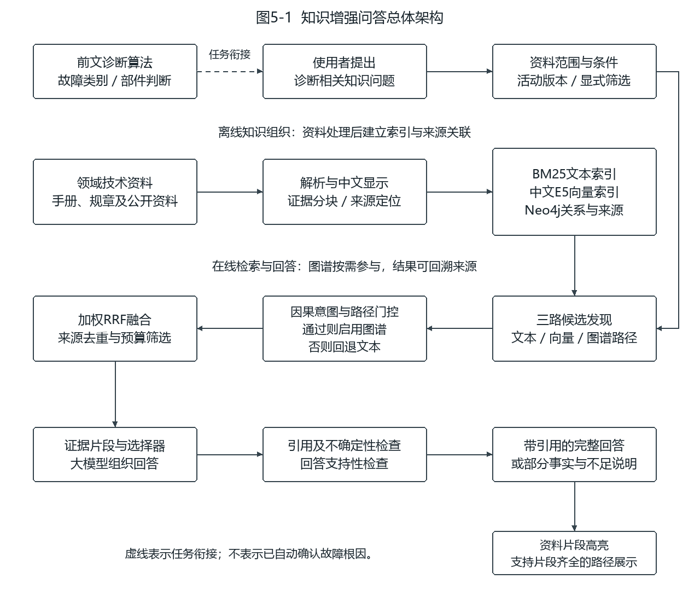
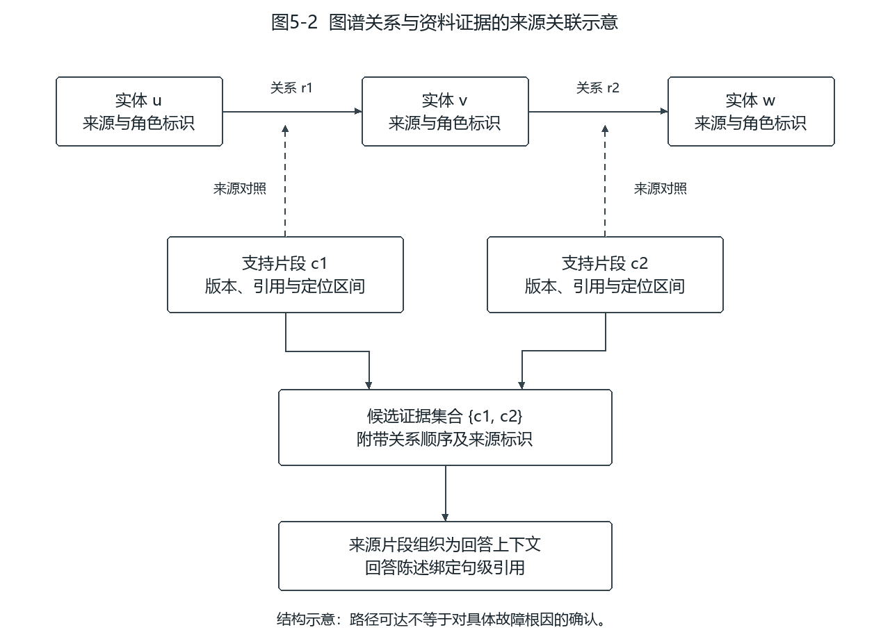
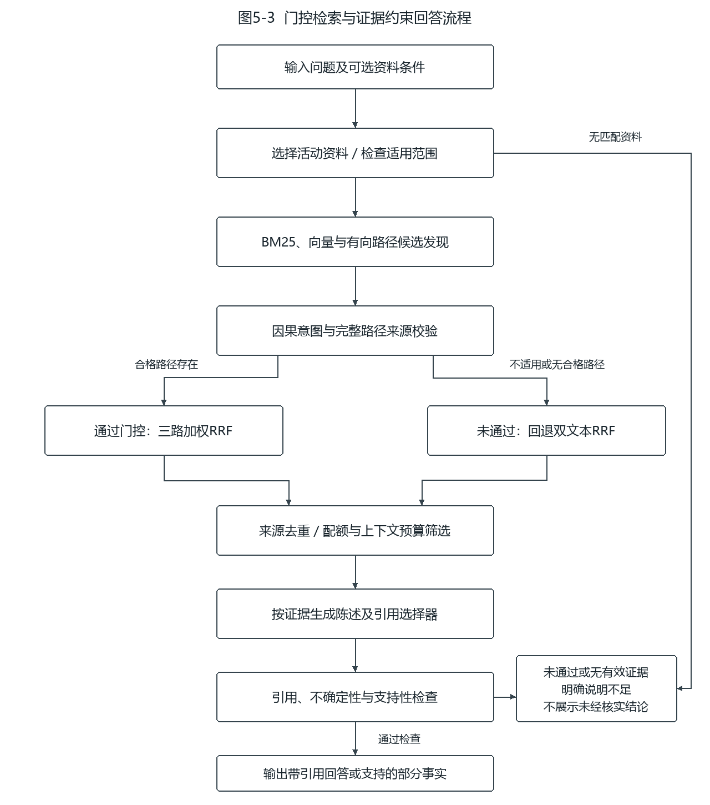
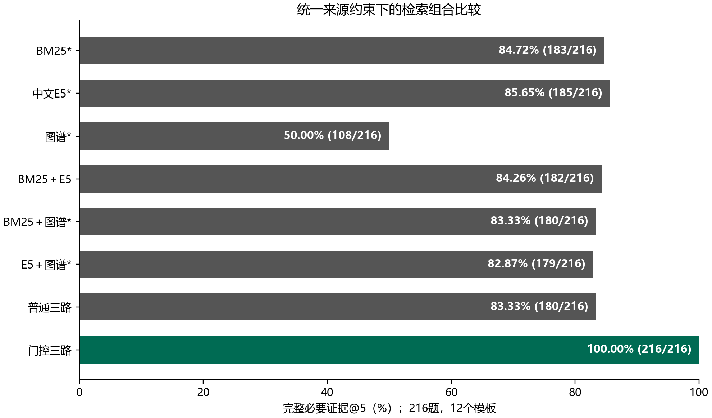
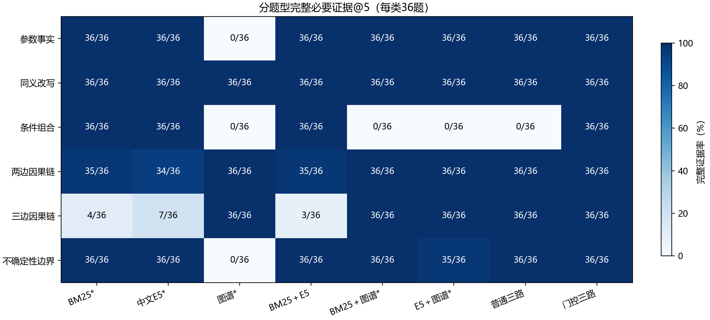
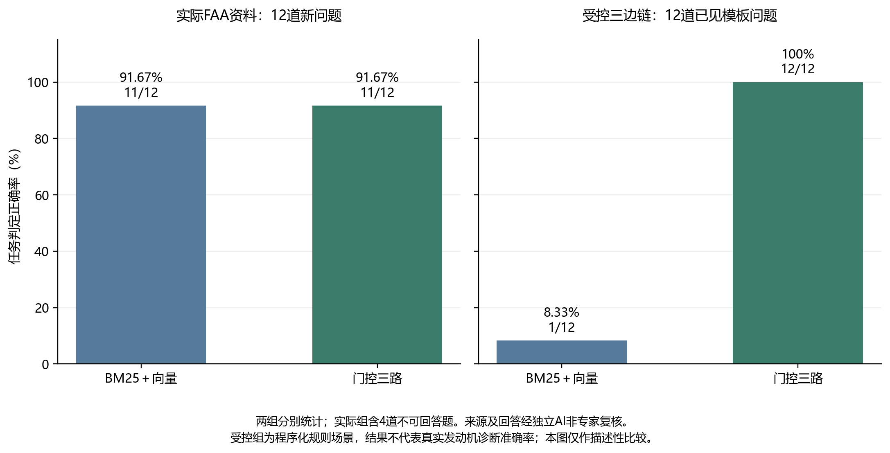

# 第五章 面向航空发动机故障诊断的知识增强问答方法

## 5.1 引言

前文围绕航空发动机故障诊断算法开展研究，通过对运行数据中故障相关特征的分析，为故障识别提供了方法支持。然而，在实际诊断过程中，获得故障类别或相关部件的判断并不意味着诊断任务已经结束。针对诊断结果，使用者通常仍需进一步查阅技术资料，了解相关异常的形成机理、可能涉及的部件及后续检查依据，并判断这些知识是否适用于当前问题。因此，如何将数据驱动的故障判断与领域知识的查询和解释相结合，是完善故障诊断支持能力需要考虑的问题。

航空发动机相关知识通常分散于技术手册、规章和公开技术资料之中。其中，部分问题可以通过单个资料片段回答，而涉及故障机理或关联关系的问题，可能需要联合多个片段中的证据。例如，对某一异常现象的解释，可能需要同时获得上游影响因素、中间作用环节及下游表现等信息。仅依据问题与文本的相似度进行检索，未必能够同时保留这些必要证据；另一方面，无差别引入图谱关系也可能干扰与问题直接相关的文本证据。因此，需要结合问题特点，研究文本证据与关系知识的组织和使用方式。

大语言模型能够以自然语言组织检索结果，为领域知识交互提供了一种实现途径，但其生成内容仍需受到外部证据约束。尤其对于故障机理、适用条件和不确定原因等问题，若缺少来源约束，可能将相关性描述误写为确定因果关系，或在证据不完整时给出超出资料范围的结论。为此，本章将“知识增强”具体落实为领域资料对检索过程和回答过程的约束：以可定位的资料片段提供事实依据，以来源绑定的知识图谱组织显式关系，并在回答中保留引用及证据不足说明。

检索增强生成通过将外部检索证据与语言生成相结合，为知识密集型问答提供了一种实现方式[1]。知识图谱则利用实体、关系及上下文组织关联知识[2]。面向工业维护，Lin等提出MAKG框架，将图谱、检索增强生成和多智能体协作结合，并采用领域嵌入适配支持维护知识处理[3]。带引用生成研究进一步强调，回答正确性与引用质量需要分别评价[4]。这些工作为本章提供了方法依据。本章侧重来源绑定的证据组织、按需引入关系路径及可核查回答，不将多智能体协作或嵌入模型微调作为本章贡献，也不与上述研究在不同数据集上的指标直接比较。

基于上述考虑，本章面向航空发动机故障诊断中的知识查询与解释需求，构建知识增强问答方法。在离线阶段，对领域资料进行解析和证据组织，建立文本索引、向量索引及来源关联图谱；在在线阶段，采用来源约束下的文本混合检索，并根据问题的因果意图与图谱路径的来源校验结果，决定是否引入图谱候选参与融合排序。在此基础上，通过片段级引用与回答检查，使生成内容能够回溯至相应资料，并在现有证据不足以回答问题时明确指出缺失。

本章与前文诊断算法之间形成任务上的衔接：前文侧重利用数据获得故障判断，本章侧重围绕诊断相关问题提供可核查的领域知识支持。诊断结果可以作为使用者提出后续问题的背景，但本章不以提高前文分类模型的识别准确率为目标，也不将资料中的因果路径直接等同于对当前发动机故障原因的确认。后续将通过检索组合对比、分题型评价和消融实验分析所提方法的适用条件，并结合实际资料问答案例验证系统功能。

## 5.2 知识增强问答总体框架

### 5.2.1 任务定义与输入输出

前文故障诊断算法主要根据运行数据中的特征形成故障判断。在获得诊断结果后，使用者仍可能需要查询相关机理、适用条件和检查依据。本章面向这一后续知识需求，将诊断相关知识问答定义为：在给定领域资料及其适用范围的条件下，检索与问题相关的证据，并据此形成能够回溯至资料来源的自然语言回答。

设领域资料集合为 \(\mathcal{D}\)，由资料解析得到的证据片段集合为 \(\mathcal{C}\)，来源关联图谱为 \(\mathcal{G}\)。用户输入由问题 \(q\) 和可选筛选条件 \(\xi\) 组成，其中 \(\xi\) 可以包括指定文档、发动机型号、飞行阶段或来源修订信息。问答过程表示为

\[
(\mathcal{E}_q,\mathcal{P}_q,A_q,z_q)=F(q,\xi;\mathcal{C},\mathcal{G}), \tag{5-1}
\]

其中，\(\mathcal{E}_q\) 为检索得到的证据片段，\(\mathcal{P}_q\) 为满足来源校验和展示条件的路径，\(A_q\) 为带引用的回答，\(z_q\) 表示当前证据是否足以支持完整回答。当证据不充分时，系统输出缺失说明，并可以保留已经获得支持的部分事实。

上述定义将知识增强的作用限定在三个方面：通过领域资料补充模型回答所需的事实依据，通过图谱关系组织分散的关联证据，以及通过来源引用和不确定性检查约束回答内容。其中，诊断算法输出可以作为使用者组织问题的背景。例如，使用者可以围绕已获得的部件判断，查询相关异常的作用机理或检查依据。本章实现采用自然语言问题作为问答入口，前文诊断模型与问答模块之间的衔接体现在任务层面，尚不将模型输出直接作为自动确认故障根因的条件。

对于多跳问题，本章关注的是沿资料明确陈述的有向关系发现路径，并检索支持各关系的原始证据。即使存在 \(u\rightarrow v\rightarrow w\) 的关系链，也需要考虑各关系所处的来源、条件和确定性，不能仅依据图上的可达性确认某一具体发动机的故障原因。因此，路径结果用于提供可检查的知识关联，而不作为现场诊断结论的替代。

### 5.2.2 总体架构与工作流程

总体框架包括离线知识组织与在线检索回答两个阶段，如图5-1所示。离线阶段对领域资料进行解析，保留文本结构及来源位置，构建文本索引、向量索引和来源关联图谱；在线阶段根据用户问题选择活动资料，联合文本检索与图谱候选发现，经门控和融合排序形成回答上下文，再生成并检查回答。

图5-1中，文本索引和向量索引均以资料片段为检索对象。两者分别从词项匹配和语义匹配角度提供候选证据。图谱保存实体、关系及其来源关联，并将检索到的关系路径映射回对应资料片段。由此，三路检索可以在共同的证据标识上进行融合，避免将缺少来源的关系标签直接视为回答依据。

在线阶段首先确定资料范围。在此基础上，BM25和向量检索提供文本候选，图谱检索提供关系关联的候选片段。系统根据问题的因果意图以及是否存在通过来源校验的完整路径，决定图谱候选是否参与融合。若条件满足，则执行三路加权排序；若不满足，则回退文本检索。该过程不要求每个问题都使用图谱，从而保留文本检索对事实查询和条件查询的覆盖能力。

融合后得到的片段进一步经过来源去重、文档配额和上下文预算筛选。回答模块依据实际进入上下文的片段组织陈述，并为每项陈述附加来源选择器。随后执行引用定位、不确定性和回答支持性检查，输出带引用的回答或证据不足说明。用户能够从回答进入来源片段，核对引用内容及位置；对于支持证据齐全的路径，还可以逐条查看其关系依据。

离线资料更新与在线问答相互分离。新增资料或修订版本在处理后进入检索范围，查询期间使用活动版本约束，避免已被替代的内容继续作为当前依据。该设计使资料维护能够独立于每次提问完成，同时为回答与来源的一致性检查提供条件。

## 5.3 领域知识组织与来源关联

### 5.3.1 文档处理与证据单元构建

领域资料的文件格式和表达形式存在差异。PDF、Word、HTML及结构化表格中的知识，需要先转换为具有来源信息的文本表示。本章复用现有文档解析组件，提取段落、标题和表格等结构，并保留能够获得的页码、文本区间和文件版本信息。解析结果既用于文本检索，也作为图谱关系来源校验的基础。

设第 \(i\) 个证据片段表示为

\[
c_i=(\mathrm{id}_i,d_i,v_i,t_i,\widetilde t_i,\ell_i,m_i), \tag{5-2}
\]

其中，\(d_i\) 和 \(v_i\) 分别表示文档及版本标识，\(t_i\) 为来源文本，\(\widetilde t_i\) 为用于中文检索和显示的文本，\(\ell_i\) 为来源定位信息，\(m_i\) 为适用范围等元数据。中文资料可以直接采用来源文本；英文资料在获得中文译文后，通过来源文本的哈希记录译文所对应的版本。若译文记录与来源版本不一致，则不将其作为已验证的中文显示文本使用。哈希检查用于发现内容版本错配，本身并不验证翻译语义是否准确。

证据划分兼顾检索粒度与来源上下文。片段过长时，问题相关信息容易被其他内容稀释；片段过短时，条件、否定或适用范围可能与主陈述分离。因此，资料组织采用结构化分段和分层证据记录，在可获得的标题、段落和表格边界附近构建检索片段，并保留与较完整上下文之间的关联。后续问答以实际检索到的片段为基础，不将整个文档默认视为已经进入生成上下文。

来源文本和中文显示文本具有不同的定位空间。原文件页码和解析区间用于回溯资料；回答引用的字符偏移则对应实际提供给模型的显示文本。对于译文，不能直接将显示文本偏移解释为英文原文件页内坐标。系统在原文查看界面显示资料名称、版本与可获得的页码，并在中文片段内高亮引用内容，以保持引用范围明确。

### 5.3.2 图谱模式与来源绑定

为组织与诊断相关的显式知识，图谱采用属性图表示

\[
\mathcal{G}=(\mathcal{V},\mathcal{R},\mathcal{A}), \tag{5-3}
\]

其中，\(\mathcal{V}\) 为实体集合，\(\mathcal{R}\) 为有向关系集合，\(\mathcal{A}\) 为实体和关系的属性集合。模式围绕发动机、部件、症状、原因、作用机理、参数、检查、处置及条件等知识对象设置。类型的作用在于区分对象角色和关系用途，而不追求覆盖航空发动机领域的完整本体。

表5-1 主要知识对象及其组织用途

| 对象或关系 | 表示内容 | 在本章中的用途 |
|---|---|---|
| 发动机、部件 | 诊断对象及其组成部分 | 确定知识涉及的对象与范围 |
| 症状、参数 | 异常表现与可观测量 | 关联问题中的现象和技术量 |
| 原因、作用机理 | 来源陈述的影响因素及作用环节 | 构建有向关联路径 |
| 检查、处置 | 检查手段与来源给出的行动建议 | 支持检查依据和维修知识查询 |
| 条件 | 来源明示的适用前提 | 限定关系与回答的适用范围 |
| 导致、促成 | 明确因果或贡献关系 | 作为受约束因果路径的关系类型 |
| 指示、检查方式、缓解措施等 | 指标含义及非因果关联 | 保留相关知识，不统一解释为因果关系 |

关系记录除头实体、关系类型和尾实体外，还保存来源文档、版本、支持片段、引用文本、定位区间、极性、确定性及条件信息。设一条来源关系记录为

\[
r_j=(u_j,p_j,w_j;d_j,v_j,S_j,\eta_j), \tag{5-4}
\]

其中，\(S_j\) 为支持该关系的一个或多个资料片段，\(\eta_j\) 为确定性、极性和适用条件等属性。通过该表示，图谱关系能够回溯到资料中的具体表述，而不只保留脱离上下文的三元组。图5-2给出了关系、证据与回答引用之间的对应关系。

实体连接采用保守的来源约束。只有在实体提及具备有效来源定位、角色和类型一致，并且处于相同文档与版本范围时，才依据来源中经既定术语规范化后相同的表述建立连接。仅有名称相似或翻译相近不足以合并实体；无法完成连接校验的对象保留为独立提及。该处理有助于减少同名对象、不同条件或不同来源之间的误连，但也会限制可检索路径的数量。

图谱构建使用基于来源片段的抽取与校验流程，对未通过来源定位或关系属性检查的候选进行修订或排除。图谱中的“导致”“指示”和“建议检查”等关系分别保留原有语义，不将一般关联转换为确定因果。对多跳检索，进一步限定可参与门控的关系类别和确定性，以防止将若干相关片段连接后解释为资料未陈述的故障结论。

实际资料知识库与自建场景实验采用不同的数据构建条件。实际资料图谱包含抽取和来源复核环节；自建场景实验的关系则由明确设定的因果记录子集编译，用于检验检索和融合机制。这两类图谱的结果应分别解释，规则构造图谱的检索表现不能直接作为实际资料自动抽取质量的评价。

### 5.3.3 知识索引与版本维护

文本片段采用BM25索引与中文语义向量索引并行组织，图谱采用Neo4j保存实体和关系属性。文档、版本和片段标识贯穿三种表示，使检索结果能够回到同一来源记录。图谱检索最终返回的也是支持关系的资料片段，从而能够与文本通道按片段标识合并。

资料更新以版本为单位管理。对于同一逻辑文档，修订内容形成新的版本，经解析和索引处理后再切换为活动版本，旧版本保留历史身份，但不继续参与面向当前资料的问答。来源条件不明确时保留未知状态，不根据缺失信息推断资料对某型号或飞行阶段通用。

在线查询先根据活动版本及用户指定的资料条件确定范围。若用户显式指定的资料或编号没有对应记录，则返回无匹配证据，而不自动扩大到其他来源。对于存在明确适用条件的资料和关系，检查其与问题条件是否冲突；严格筛选模式进一步排除无法确认适用性的证据。对于缺少充分条件信息的片段，其适用状态随证据传递到回答阶段。

为避免生成期间发生版本变化，回答返回前再次检查来源可见性和显示文本哈希；若资料已被替代或文本发生变化，则要求重新检索。来源查看接口同样校验活动版本，使用户看到的片段与当前有效资料相对应。该机制用于维护检索、生成和查看环节的一致性，而不替代资料内容本身的专业审核。

## 5.4 门控混合检索与证据约束回答

### 5.4.1 来源约束的文本混合检索

词项检索和向量检索对问题表述具有不同的响应特点。BM25依据词项匹配提供候选[5]，便于保留问题中的技术术语和明确标识；向量检索通过问题与片段的语义表示计算相似度，补充表述差异较大的相关内容。本章将两者作为文本检索基础，并在检索前统一限定来源范围。

令 \(\Omega(q,\xi)\) 为符合活动版本及查询条件的资料集合，则文本候选表示为

\[
\mathcal{C}_B=\operatorname{Top}_{n_B}\{s_B(q,c):c\in\Omega(q,\xi)\},\qquad
\mathcal{C}_D=\operatorname{Top}_{n_D}\{s_D(q,c):c\in\Omega(q,\xi)\}. \tag{5-5}
\]

其中，\(s_B\) 为BM25排序得分，\(s_D\) 为语义相似度。词项索引针对英文标识及中文文本保留相应词项表示，中文向量通道采用本地多语言E5模型[6]，分别编码问题和片段，并使用余弦相似度进行排序：

\[
s_D(q,c)=\frac{\boldsymbol{h}_q^{\mathsf T}\boldsymbol{h}_c}
{\|\boldsymbol{h}_q\|\,\|\boldsymbol{h}_c\|}. \tag{5-6}
\]

对英文来源，语义索引以与来源版本关联的中文显示文本作为输入，减少中文问题直接匹配英文片段时的语言表示差异。该处理并不保证所有跨语言问题均能正确匹配，仍需通过实际资料和问题检验其效果。

来源约束位于各通道检索之前，而不是在全库TopK结果返回后再删除不匹配来源。这样能够避免其他资料占据候选配额后，使指定来源的相关片段无法进入比较范围。对于基于编号的约束，仅识别问题中显式出现、符合既定形式的标识，并在来源文本中进行匹配，不推断缺失编号或未声明的型号关系。

### 5.4.2 有向多跳路径检索

对于涉及多个作用环节的问题，仅返回与起点或终点相似的片段可能不足以解释两者之间的关系。本章在文本检索之外，从来源关联图谱发现有向路径，并检索支持路径各边的资料片段。

路径表示为

\[
P=(u_0\xrightarrow{r_1}u_1\xrightarrow{r_2}\cdots
\xrightarrow{r_L}u_L),\qquad 1\leq L\leq3, \tag{5-7}
\]

其中，\(L\) 为关系边数。候选发现以问题与实体名称之间的词项关联选择起始对象，在有向邻接关系上进行有界遍历，并限制访问次数、分支数和最大路径长度。遍历过程中不重复访问同一路径中的实体身份，以控制循环和无界扩展。候选发现可以包含单边路径，但触发最终图谱参与门控的路径需要具备2—3条有效因果边。

路径候选排序结合实体链与来源文本的匹配程度。记 \(\rho(q,x)\) 为经过既定术语规范化后的词项覆盖得分，\(N(P)\) 为路径实体名称的串联文本，\(T(P)\) 为各边的中文支持片段集合，采用

\[
s_P(q,P)=\frac{0.75\rho(q,N(P))+0.25\max_{t\in T(P)}\rho(q,t)}
{1+0.04(L-1)}. \tag{5-8}
\]

式中，实体链匹配用于衡量路径与问题对象的关联，来源片段匹配用于补充文本信号，分母对较长路径施加轻度折减。该得分只用于候选排序，不表示关系为真的概率，也不是诊断置信度。

设路径所需支持片段的并集为

\[
S(P)=\bigcup_{j=1}^{L}S(r_j). \tag{5-9}
\]

图谱通道将 \(S(P)\) 中的原始片段作为候选返回，同时保留路径的关系顺序、方向、确定性、条件和支持位置。若一条边需要多个来源片段共同支持，则这些片段均计入路径证据，而不只计算其中一条引用。由此，图谱的作用是补充与关系链相关的来源证据，而不是为大模型直接提供一条未经核查的推理结论。

### 5.4.3 路径可信度门控与融合排序

图谱关系覆盖不均，且部分问题不需要因果路径。如果对所有问题无差别加入图谱候选，可能使原本相关的事实或条件证据排序下降。因此，本章设置查询级门控，由问题意图与路径来源校验共同决定图谱是否参与。

令 \(I(q)\) 表示基于规则识别的因果路径查询意图，\(\Pi(q)\) 为发现的路径集合，\(V(P,q,\xi)\) 表示路径校验结果，则门控定义为

\[
g(q,\xi)=I(q)\land\left[\exists P\in\Pi(q):V(P,q,\xi)=1\right]. \tag{5-10}
\]

意图规则关注“因果”“机理”“路径”“中间环节”等表达，并对要求确定归因、反向推断和不确定性边界的问题采用保守回退。该规则是当前实现中的有限表达匹配，不等同于能够覆盖任意语言形式的意图分类模型。

路径校验要求同时满足以下条件：路径由2—3条方向连续的关系构成；关系属于允许的因果类型，具有明确的正向极性及规定的确定性状态；实体与边的来源标识一致，且处于同一来源文档和版本；实体连接和每条关系的引用区间有效；路径两端与问题中的对象满足既定匹配条件；关系适用条件不与查询冲突；支持整条路径的片段均包含在图谱候选配额内。仅有图上连通或名称相近不足以通过校验。

当 \(g=1\) 时，BM25、向量与图谱三路候选共同融合；当 \(g=0\) 时，只保留两路文本候选。图谱不可用或快照无法完成校验时，同样回退文本。门控判断基于问题和实际候选，不读取题型标注、参考答案或必要证据标签。

以倒数排名融合（reciprocal rank fusion，RRF）[7]为基础，采用加权形式整合各通道排名。令 \(\mathcal{H}(q)\) 为实际启用的通道集合，\(r_h(c)\) 为片段 \(c\) 在第 \(h\) 路中的排名，缺失通道不贡献分数，则

\[
s_F(c\mid q)=\frac{\displaystyle\sum_{h\in\mathcal{H}(q)}
\frac{w_h\,\mathbf{1}[c\in\mathcal{C}_h]}{\kappa+r_h(c)}}
{\displaystyle\sum_{h\in\mathcal{H}(q)}\frac{w_h}{\kappa+1}}. \tag{5-11}
\]

分母为通道权重对应的归一化常数，不改变同一次查询的排序。采用排名融合能够避免直接相加BM25得分、余弦相似度与路径得分时的量纲差异。当前配置取 \(\kappa=60\)，三路权重为 \(w_B=1\)、\(w_D=0.25\)、\(w_G=0.25\)。配置选择与评价依据在5.5节说明，不将其解释为对所有资料均适用的最优权重。

表5-2 门控混合检索与上下文组织参数

| 参数 | 当前设置 | 含义 |
|---|---:|---|
| 三路候选上限 | 每路50条 | 总上限150条 |
| 文本回退候选 | BM25 50条、向量50条 | 不将图谱配额重新分配给文本 |
| 融合候选池 | 前50条 | 按融合排序进入证据筛选 |
| 最终证据条数 | 最多10条 | 同时受文档配额和文本预算约束 |
| 每文档证据上限 | 5条 | 避免单一文档占据全部结果 |
| 检索正文预算 | 4096个计数token | 采用本地E5分词器计数 |
| 路径发现长度 | 1—3条边 | 触发门控需2—3条有效因果边 |
| 遍历控制 | 32个起始候选、每次扩展最多24条边、访问预算4000 | 控制搜索规模 |

融合后的证据按得分顺序进行来源去重和预算筛选。去重限于同一文档、同一版本内的相同文本或能够确认被已选片段完整覆盖的锚定内容，不因语义相近而删除独立来源，也不丢弃部分重叠片段中尚未保留的尾部内容。依次加入片段时检查文档配额及文本预算；当前候选超过正文预算时停止该次选择，以保持确定性的有序筛选行为。

门控与路径完整性展示分别处理。设最终证据集合为 \(\mathcal{E}_q\)，则可展示路径集合为

\[
\mathcal{P}_q=\{P:V(P,q,\xi)=1,\ S(P)\subseteq\mathcal{E}_q\}. \tag{5-12}
\]

查询级门控只要求存在一条合格路径后启用图谱通道，不表示对所有入池图谱候选逐项认证，也不保证普通融合排序必然保留每条合格路径。对于未完整进入最终证据的路径，不将其展示为完整依据。最终方案采用门控RRF，而非强制整束插入路径片段，后者作为消融方法在实验中比较。

### 5.4.4 证据约束回答与引用校验

检索结果进入回答阶段后，仍需控制生成内容与来源之间的关系。本章将证据片段切分为可选择的句级区间，为每个区间分配标识，并记录显示文本内的起止偏移和文本哈希。生成模型仅接收问题、片段内容、适用状态及区间选择器，输出由若干陈述组成的回答，同时声明是否存在证据不足及其原因。

设显示文本 \(\widetilde t_i\) 中的引用区间为 \([a_{ij},b_{ij})\)，引用对象表示为

\[
\sigma_{ij}=(\mathrm{id}_{ij},\mathrm{id}_i,a_{ij},b_{ij},
H(\widetilde t_i),\widetilde t_i[a_{ij}:b_{ij}]), \tag{5-13}
\]

其中，\(H\) 为文本哈希函数。模型只能选择已经提供的区间标识，引用文本、偏移和哈希由程序从证据对象中复制。若引用标识不存在、重复或缺失，则不接受相应生成结果。引用位置由此能够与用户查看的片段建立直接对应，而不是依赖模型重新抄写原文。

回答上下文在序列化后再次检查预算，计入问题、来源标识及区间选择器等开销。不能完整装入的片段不提供给生成模型。因此，进入检索结果的证据与实际提供给生成模型的证据可能不同，分别记录为 \(\mathcal{E}_q\) 和 \(\mathcal{E}^{\mathrm{gen}}_q\)。对于图谱路径，进一步记录 \(S(P)\subseteq\mathcal{E}^{\mathrm{gen}}_q\) 是否成立，区分“路径已被检索并可展示”与“路径支持片段已全部提供给模型”。当前生成输入是来源片段及选择器，不将图谱路径直接作为模型已经执行的推理过程。

回答检查分为来源结构检查和模型支持性检查。前者核对引用标识、位置和文本版本，并检查是否将来源中的“可能”“尚不能确定”等表述改写为确定结论；后者使用模型复核陈述与引用之间的支持关系，以及问题要求是否得到覆盖。逐字引用能够证明引用位置有效，但不能单独证明该引用足以支持所写陈述，因而需要将两种检查区分开来。模型复核仍可能遗漏语义问题，其结果不等同于领域专家确认。

若生成结果未通过必要检查，系统不给出未经核实的完整结论，而是提示校验未完成并保留检索证据供查看。若模型明确声明证据不足，可以输出已经得到支持的部分事实，同时说明尚缺少的依据。对于无匹配来源、模型不可用或上下文无法形成等情况，同样返回相应说明，不将单纯检索摘录标记为完整回答。在线处理流程见图5-3。

由上述设计，领域知识在本章中不仅作为生成提示的补充文本，还参与候选来源限定、多跳关联证据发现和回答可核查性约束。文本通道承担一般知识覆盖，图谱在存在合格关系路径时提供结构性补证，引用检查则帮助使用者定位回答依据。这些环节共同构成面向诊断相关知识问题的支持方法，其有效性需结合5.5节的检索实验、分题型分析和实际资料案例进行评价。

## 5.5 实验结果与分析

### 5.5.1 实验数据与设置

为分析知识增强在检索和回答两个阶段的作用，本节分别开展检索组合实验与端到端回答实验。检索实验关注必要证据是否能够同时进入返回结果；回答实验进一步检查模型能否依据实际提供的证据形成完整陈述，以及在证据不足时是否给出恰当说明。两类实验使用不同的评价对象，检索完整率不直接作为回答正确率。

检索实验采用自建航空发动机场景评测集。该集合由AI辅助设计机理词汇模板并程序化扩展为虚拟试验台规则资料，包含36个场景、576条证据记录和216道问题。图谱由其中的明确因果记录子集编译，含288个实体提及节点和144条关系。六类问题各36道，分别为参数事实、同义改写、条件组合、两边因果链、三边因果链及不确定性边界。证据分散在不同记录是该实验的构造条件，不等同于真实文档中经过独立认证的跨自然段推理问题。

前一版本全部216道已见题用于开发，比较59组配置，共形成12744条开发排名。在实现和参数冻结后，使用12个新机理词汇模板构造本轮216题，完成12种配置的2592条排名。为补齐单路和双路组合，在测试结果可见后，沿用冻结权重增加7种描述性配置，形成1512条补充排名，合计19种配置、4104条排名。补充组合没有分别重新调优，不能解释为各组合的最优性能。最终门控方案是在观察本轮比较结果后选定的，因此本轮检索结果是冻结配置的比较依据，而不是最终选型之后再次开展的确认性验证。

端到端实验另设两组，每组12题、每题比较双文本与门控三路。第一组依据现有公开FAA资料新编问题，覆盖叶片维护、燃烧室、空气涡轮起动机和振动指导[8-10]，含4份资料摘录，对应3个原始PDF来源簇。其中8题有明确资料支持，4题要求给出摘录中不存在的通用数值界限。起动机与振动题用于辅助维修知识验证，不作为气路故障专属指标。该组属于已见来源上的新问题小规模验证，而非新来源独立测试。第二组从上述自建检索题中，按每个模板首个实例固定抽取12道三边链题，检验路径证据在回答阶段的作用，属于已见场景上的能力诊断。

表5-3 实验数据与用途

| 数据组 | 数量与组成 | 来源及划分 | 主要用途 |
|---|---|---|---|
| 开发题 | 216题；59组配置 | 旧自建题，全部已见 | 配置选择 |
| 自建场景检索题 | 216题；六类各36题 | 12个新词汇模板；共享构造语法 | 检索组合、分型与消融 |
| 实际资料问答题 | 12题：8题可回答、4题数值边界 | 已有4份FAA摘录、3个原PDF簇；新编问题 | 回答完整性、引用与拒答 |
| 受控三边链问答题 | 12题；每模板固定1题 | 已见自建规则场景 | 完整路径证据对回答的作用 |

问题、必答点、来源锚点、运行代码和评价规则在新答案生成前冻结。两组问题分别通过独立AI非专家来源复核；生成完成后隐藏检索方法名称，按随机标识对48份回答进行独立AI非专家评分。复核未读取方法身份映射、耗时或费用信息。该过程提高了评价与生成的分离程度，但不构成行业专家金标准。两组数据分别报告，不合并为真实场景总体正确率。

端到端对照中，双文本采用BM25和中文E5各75条候选，权重为1∶0.25；门控三路采用每路50条候选，权重为1∶0.25∶0.25，门控关闭时仍使用50＋50文本候选。两种方案均采用相同来源范围、RRF常数、文档配额和上下文预算。因候选总额相同而各路配额不同，比较包含候选分配的影响，不能将全部差异视为只增加图谱后的独立因子效应。

回答模型统一采用DeepSeek Flash，关闭思考模式，温度设为0，单次输出上限为1024 token；回答和支持性检查使用相同提示规则。每道题内的执行顺序按编号交替。完全相同的请求允许复用精确输入缓存，并记录缓存命中；缓存答案不作为独立随机重复。实际资料组使用本机中文E5和Neo4j链路，受控组使用已冻结的向量索引和规则图快照，不评价图数据库吞吐性能。

### 5.5.2 评价指标

设问题的必要证据集合为 \(S_q\)，前 \(K\) 条检索结果为 \(R_q^K\)，检索完整率定义为

\[
\mathrm{Complete}@K=\frac{1}{N}\sum_{q=1}^{N}\mathbf{1}[S_q\subseteq R_q^K]. \tag{5-14}
\]

该指标要求必要证据同时出现，适合识别多证据问题中仅命中部分片段的情况。召回率和精确率分别定义为

\[
\mathrm{Recall}@K=\frac{1}{N}\sum_q\frac{|S_q\cap R_q^K|}{|S_q|},\qquad
\mathrm{Precision}@K=\frac{1}{N}\sum_q\frac{|S_q\cap R_q^K|}{K}. \tag{5-15}
\]

精确率分母固定为 \(K\)，即使返回不足 \(K\) 条也不改变。使用二元相关性的归一化折损累积增益（normalized discounted cumulative gain，nDCG）[11]评价相关证据的排序位置；采用MRR评价首条相关证据的位置，并以完整MRR评价全部必要证据首次齐全的位置。若 \(r_q^\ast\) 为首次满足 \(S_q\subseteq R_q^{r_q^\ast}\) 的位置，则

\[
\mathrm{CMRR}=\frac{1}{N}\sum_q\frac{\mathbf{1}[S_q\subseteq R_q^{10}]}{r_q^\ast}, \tag{5-16}
\]

无法在前10条内完整命中时，该题贡献为0。实验以完整@5为主要检索指标，同时保留完整@3、完整@10及排序指标。

端到端实验采用问题级判定正确率。对于有答案题，要求覆盖全部必答点、陈述受到引用支持、保留条件与不确定性，且最终未错误声明证据不足；对于无答案题，要求明确说明不足，并且不编造所要求的数值界限。以 \(J_q\) 表示相应条件是否满足，则

\[
\mathrm{DecisionAcc}=\frac{1}{N}\sum_q J_q. \tag{5-17}
\]

由于该指标同时包含正确回答和正确拒答，进一步单列有答案题完整回答率、无答案题安全拒答率，以及有答案题误拒答率，避免将全部拒答都视为良好表现。无答案题不要求额外补写问题未明确要求的制造商查询建议，其是否覆盖作为次级参考点记录。

引用评价区分定位有效性与语义支持性。定位有效性由程序核验片段标识、哈希和字符区间；语义支持性由匿名复核检查陈述是否由引用内容及上下文支持。带引用生成评价强调陈述与引用之间的支持关系[4]，本章据此区分引用能够定位与引用确实支持陈述两类检查，不将本节指标等同于ALCE官方基准得分。最终保留陈述的引用支持率为

\[
\mathrm{CitationSupport}=\frac{\text{获得引用语义支持的最终陈述数}}{\text{最终保留的事实陈述总数}}. \tag{5-18}
\]

没有事实陈述的拒答不凭空增加该指标的分母或分子。该指标只描述经过回答检查后实际展示的内容，不代表未经筛选的原始模型输出不存在错误。

### 5.5.3 单路、双路与三路检索对比

首先在全库检索设置下比较三种单路、三种双路及普通三路，结果见表5-4。各配置候选总上限相同，所用权重继承对应冻结配置；带“*”的双路配置为补充描述性消融。

表5-4 全库检索组合比较

| 方法 | 完整@3 | 完整@5 | 完整@10 | Recall@5 | nDCG@5 | MRR | 完整MRR |
|---|---:|---:|---:|---:|---:|---:|---:|
| BM25 | 132/216 | 146/216 | 147/216 | 0.8194 | 0.7989 | 0.8681 | 0.5701 |
| 中文E5 | 159/216 | 170/216 | 179/216 | 0.9005 | 0.8691 | 0.9091 | 0.6119 |
| 图谱路径 | 96/216 | 96/216 | 96/216 | 0.4444 | 0.4427 | 0.4421 | 0.2477 |
| BM25＋E5 | 150/216 | 156/216 | 170/216 | 0.8719 | 0.8493 | 0.9016 | 0.6018 |
| BM25＋图谱* | 101/216 | 127/216 | 182/216 | 0.7585 | 0.7101 | 0.8179 | 0.4250 |
| E5＋图谱* | 147/216 | 187/216 | 198/216 | 0.9398 | 0.8210 | 0.8308 | 0.4900 |
| 普通三路 | 152/216 | 161/216 | 183/216 | 0.8974 | 0.8286 | 0.8816 | 0.5067 |

全库检索中，中文E5完整@5为170/216，高于双文本的156/216；E5＋图谱为187/216，也高于普通三路的161/216。因此，增加通道数量并不保证结果单调改善。候选配额、融合权重、来源范围以及图谱覆盖共同影响证据保留，不能只依据“单路、双路、三路”的数量关系解释结果。

随后统一施加来源约束，比较完整七组合与最终门控方案，结果见表5-5。匹配权重配置采用1∶0.25∶0.25及其通道子集，带“*”的方法未分别重新优化。

表5-5 统一来源约束下的组合比较

| 方法 | 完整@3 | 完整@5 | 完整@10 | Recall@5 | nDCG@5 | MRR | 完整MRR |
|---|---:|---:|---:|---:|---:|---:|---:|
| BM25* | 162/216 | 183/216 | 183/216 | 0.9483 | 0.8926 | 0.8912 | 0.6353 |
| 中文E5* | 175/216 | 185/216 | 185/216 | 0.9367 | 0.9019 | 0.9124 | 0.6449 |
| 图谱路径* | 108/216 | 108/216 | 108/216 | 0.5000 | 0.4983 | 0.4977 | 0.3032 |
| BM25＋E5 | 164/216 | 182/216 | 182/216 | 0.9468 | 0.8947 | 0.8958 | 0.6356 |
| BM25＋图谱* | 104/216 | 180/216 | 180/216 | 0.9167 | 0.6492 | 0.5792 | 0.3514 |
| E5＋图谱* | 108/216 | 179/216 | 179/216 | 0.9120 | 0.6648 | 0.5991 | 0.3674 |
| 普通三路（匹配权重） | 107/216 | 180/216 | 180/216 | 0.9167 | 0.6532 | 0.5843 | 0.3553 |
| 门控三路 | 215/216 | 216/216 | 216/216 | 1.0000 | 0.9843 | 0.9838 | 0.7049 |

来源约束双文本完整@5为182/216（84.26%），门控三路为216/216（100.00%），增加34题，即15.74个百分点。门控三路nDCG@5为0.9843，MRR为0.9838；但来源约束E5单路仍以185/216略高于双文本，说明文本融合本身也未在本组任务上形成普遍优势。上述结果支持按问题特点使用关系知识，而不支持通道数越多越好的结论。

本组问题均包含明确试验台标识，来源筛选具有较强的可操作性，结果依赖这一受控设定。新旧模板共享生成语法，因此即使词汇不同，也不能将本组满分解释为实际发动机资料检索已经解决。

### 5.5.4 分题型与消融分析

表5-6比较双文本、独立调优普通三路、匹配权重普通三路和门控三路的分题型完整@5。每类36题，保留所有题型及失败结果。

表5-6 分题型完整证据@5

| 题型 | 双文本 | 独立调优三路 | 匹配权重普通三路 | 门控三路 |
|---|---:|---:|---:|---:|
| 参数事实 | 36/36 | 36/36 | 36/36 | 36/36 |
| 同义改写 | 36/36 | 36/36 | 36/36 | 36/36 |
| 条件组合 | 36/36 | 32/36 | 0/36 | 36/36 |
| 两边因果链 | 35/36 | 36/36 | 36/36 | 36/36 |
| 三边因果链 | 3/36 | 32/36 | 36/36 | 36/36 |
| 不确定性边界 | 36/36 | 36/36 | 36/36 | 36/36 |

双文本在两边链上为35/36，在三边链上仅为3/36；门控三路分别为36/36和36/36。配对比较中，新增完整命中来自1道两边链题和33道三边链题，其余四类题的完整率保持不变。这表明，在本实验的规则资料中，图谱路径能够补充文本通道未同时保留的中间证据。

相同权重下，取消门控后普通三路在条件组合题上为0/36，而门控三路为36/36。二者的36题差异全部来自条件组合题，主要作用是通过文本回退避免图谱干扰，而不是新增关系证据。该结果说明，多跳补证与抑制不适用图谱候选是两种不同的收益来源。

进一步比较来源约束、单边图谱、门控及完整路径插入等配置，结果见表5-7。

表5-7 关键配置与消融结果

| 方法 | 完整@3 | 完整@5 | 完整@10 | Recall@5 | nDCG@5 | MRR | 完整MRR |
|---|---:|---:|---:|---:|---:|---:|---:|
| 全库双文本 | 150/216 | 156/216 | 170/216 | 0.8719 | 0.8493 | 0.9016 | 0.6018 |
| 来源约束双文本 | 164/216 | 182/216 | 182/216 | 0.9468 | 0.8947 | 0.8958 | 0.6356 |
| 普通三路（独立调优） | 148/216 | 208/216 | 208/216 | 0.9846 | 0.7595 | 0.6884 | 0.4471 |
| 普通三路（匹配权重） | 107/216 | 180/216 | 180/216 | 0.9167 | 0.6532 | 0.5843 | 0.3553 |
| 单边图谱三路 | 107/216 | 180/216 | 180/216 | 0.9167 | 0.6518 | 0.5819 | 0.3546 |
| 门控三路 | 215/216 | 216/216 | 216/216 | 1.0000 | 0.9843 | 0.9838 | 0.7049 |
| 全局文本＋完整路径插入 | 156/216 | 193/216 | 205/216 | 0.9468 | 0.9119 | 0.9144 | 0.6587 |
| 来源约束完整路径插入 | 184/216 | 216/216 | 216/216 | 1.0000 | 0.9434 | 0.8981 | 0.7006 |

全库双文本与来源约束双文本由156/216变为182/216，但两者同时采用不同的开发选定权重，因此不能把净增26题全部解释为来源筛选的纯因子效应。对于同权重单边三路和路径三路，完整@5均为180/216，表明仅扩展路径候选而不控制其适用性，没有提高总体完整率。

门控三路与完整路径插入均为216/216，但前者完整@3为215/216，后者为184/216；nDCG@5分别为0.9843和0.9434。整束插入能够提供路径共同保留的工程约束，却不必然获得更好的排序。因此，最终实验方案采用门控RRF，将完整路径插入保留为消融对照，而不将其额外复杂性解释为已证实的收益。

在统计解释上，自建题在模板内存在相关性，不能将216题视为216个独立实测案例。原冻结协议针对完整路径方案设定的模板聚类检验仍保留在实验记录中，不改写为针对最终门控选型的预登记检验。本章对最终门控方案的比较采用描述性指标，并结合配对改善及退化题数解释，不以测试后选型的结果宣称已经完成独立显著性确认。

### 5.5.5 端到端回答实验

为检验检索结果能否转化为可用回答，按照5.5.1节设置完成24题、48份配对回答。没有删题、事后改写必答点或按结果重跑；两种方法均完成全部预定案例。匿名复核结果见表5-8。

表5-8 端到端问题级评价结果

| 数据组 | 方法 | 判定正确（含正确拒答） | 有答案题完整回答 | 无答案题安全拒答 | 有答案题误拒答 | 图谱启用 |
|---|---|---:|---:|---:|---:|---:|
| 实际FAA资料 | 双文本 | 11/12（91.67%） | 7/8 | 4/4 | 1/8 | 0/12 |
| 实际FAA资料 | 门控三路 | 11/12（91.67%） | 7/8 | 4/4 | 1/8 | 0/12 |
| 受控三边链 | 双文本 | 1/12（8.33%） | 1/12 | 不适用 | 11/12 | 0/12 |
| 受控三边链 | 门控三路 | 12/12（100.00%） | 12/12 | 不适用 | 0/12 | 12/12 |

实际FAA组两种方案均为11/12，且12个配对案例全部持平。8道可回答题中完整回答7道，4道数值边界题全部安全拒答。该组没有任何问题触发合格图谱路径，两种方案返回相同上下文并得到相同回答，因而没有显示图谱的额外收益；持平也不构成统计等效的证明。

两种方法共同未完整回答的案例涉及空心叶片凹痕接受条件。模型复述了形状和无开裂、撕裂等条件，但仍认为这些通用凹痕条件与空心叶片之间的对象范围关联不够明确，最终声明证据不足。按冻结评价规则，有答案题的最终拒答不能记为完整回答，因此该题保留为误拒答。此例反映了保守回答与段落范围理解之间的张力；由于参考标注和复核均为非专家，具体适用范围仍需专业人员确认，不能为提高分数而在结果可见后修改标签。

受控三边链组中，双文本完整回答为1/12，门控三路为12/12，配对改善11题、退化0题、持平1题。双文本有11题返回证据不足；门控三路在全部12题上启用图谱并保留完整来源路径。该组结果表明，当问题确实需要三条规则记录共同支持且关系来源已知时，路径检索的补证可以改善回答完整性。不过，这些是固定规则世界和已见模板的能力诊断，不能外推为真实资料中的同等增益。

进一步核对最终展示陈述的引用，结果见表5-9。程序逐条检查片段标识、哈希和引用偏移，独立匿名复核检查引用对陈述的语义支持。

表5-9 最终保留陈述的引用核验

| 数据组 | 方法 | 有来源语义支持的陈述 | 定位、偏移与哈希有效的引用 |
|---|---|---:|---:|
| 实际FAA资料 | 双文本 | 30/30 | 34/34 |
| 实际FAA资料 | 门控三路 | 30/30 | 34/34 |
| 受控三边链 | 双文本 | 5/5 | 6/6 |
| 受控三边链 | 门控三路 | 60/60 | 60/60 |

48份回答共保留125条事实陈述和134个引用，均通过相应核验。较高的引用支持率并不意味着回答完整：受控双文本虽然保留的5条陈述均获得支持，仍仅有1题完整回答。原因在于支持率只评价已经展示的陈述，不能反映未被回答的必要环节。因此，需要将引用支持率与完整回答率共同解释，也不能据此宣称原始模型的幻觉率为0。

### 5.5.6 运行记录与局限分析

实验共涉及96次逻辑模型调用，其中72次实际发送、24次命中完全相同请求的本地缓存。表5-10给出本次配对执行的墙钟时间记录。实际资料组每种方法均包含12次缓存调用，计时不能据此用于宣称某种检索方案具有普遍速度优势。

表5-10 本次端到端运行记录（包含缓存）

| 数据组 | 方法 | 单题时间中位数/s | 单题时间P95/s | 实际模型请求数 | 本地缓存命中数 |
|---|---|---:|---:|---:|---:|
| 实际FAA资料 | 双文本 | 0.934 | 2.863 | 12 | 12 |
| 实际FAA资料 | 门控三路 | 1.449 | 2.979 | 12 | 12 |
| 受控三边链 | 双文本 | 3.393 | 3.665 | 24 | 0 |
| 受控三边链 | 门控三路 | 2.350 | 3.092 | 24 | 0 |

缓存使部分相同上下文的配对回答免于重复发送，费用按实际先发送的方法记录，不能据此把方法间的费用差解释为算法成本优势。

功能验证中，69项相关回归测试、121个源文件类型检查以及前端引用、路径和转义检查通过；新运行时复放216道检索题的Top10与冻结门控结果逐题一致。这些检查用于说明方法与系统实现的一致性，不计入问答正确率。实际界面支持从回答引用进入中文片段并高亮对应内容，示例如图5-7所示。

综合上述实验，本章方法在两方面体现知识增强的作用：其一，在存在明确关系和必要证据分散的受控任务中，图谱能够补充中间环节；其二，在图谱不适用时，门控回退有助于保留文本证据的覆盖，同时通过引用和不足说明限定回答范围。知识增强的有效性取决于资料覆盖、实体连接、关系质量及问题类型，不能将规则场景成绩解释为所有实际资料均存在图谱增益。

实验还存在以下限制。首先，自建场景由程序化规则构造，显式编号和共享语法降低了部分来源识别难度；规则编译图谱没有反映实际抽取中的全部误差。其次，实际资料问答仅12题、3个原PDF来源簇，数值边界题也只覆盖较简单的一类不可回答问题，不能据4/4拒答推广到任意证据不足情形。再次，来源和回答均由AI非专家复核，未建立领域专家金标准；内部生成模型的支持性检查与外部匿名AI复核也不构成专家确认。最后，最终检索方案的选择参考了本轮检索结果，受控回答题又来自已见检索模板，后续仍需新的真实来源问题与专业审核。此前真实来源补证实验未显示稳定总体图谱优势，这一事实与本节实际资料组持平的结果共同限定了结论范围。

## 5.6 本章小结

本章面向故障诊断算法之后的领域知识查询与解释需求，研究了来源约束下的知识增强问答方法。通过资料解析和证据分块建立文本与向量索引，并以来源绑定的实体关系组织知识图谱，使文本事实、关系路径和资料片段能够相互对应。在此基础上，根据问题因果意图及路径来源校验结果决定图谱是否参与融合，在图谱不适用时回退文本检索，并通过片段级引用、不确定性及支持性检查约束生成回答。

检索实验表明，在自建规则场景中，门控三路相对来源约束双文本的完整证据@5由182/216提高至216/216，改善集中于多跳因果问题；取消门控则会干扰条件证据排序。端到端受控三边链实验中，完整回答由1/12提高至12/12，说明必要路径证据的补充能够转化为这组问题的回答完整性收益。实际FAA资料新问题实验中，两种方案均为11/12，未观察到图谱额外收益，并保留了一例保守拒答问题。

因此，本章的作用在于为诊断相关问题提供有来源的知识支持，而不直接改变前文诊断模型的识别结果，也不将图谱路径视为具体发动机根因确认。现有结果支持在合格关系路径存在时按需使用图谱，并结合文本覆盖、引用核查和证据不足说明完成知识交互；其真实场景泛化仍有待更丰富资料及专业审核验证。

## 参考文献

[1] LEWIS P, PEREZ E, PIKTUS A, et al. Retrieval-augmented generation for knowledge-intensive NLP tasks[C]//Advances in Neural Information Processing Systems. 2020, 33: 9459-9474.

[2] HOGAN A, BLOMQVIST E, COCHEZ M, et al. Knowledge graphs[J]. ACM Computing Surveys, 2021, 54(4): 71:1-71:37. DOI: 10.1145/3447772.

[3] LIN J, CHEN C, WANG T, et al. A Multi-Agent and synergistic Knowledge Graph retrieval-augmented generation framework for intelligent maintenance[J]. Journal of Manufacturing Systems, 2026, 85: 557-570. DOI: 10.1016/j.jmsy.2026.02.016.

[4] GAO T, YEN H, YU J, et al. Enabling large language models to generate text with citations[C]//Proceedings of the 2023 Conference on Empirical Methods in Natural Language Processing. Singapore: Association for Computational Linguistics, 2023: 6465-6488. DOI: 10.18653/v1/2023.emnlp-main.398.

[5] ROBERTSON S, ZARAGOZA H. The probabilistic relevance framework: BM25 and beyond[J]. Foundations and Trends in Information Retrieval, 2009, 3(4): 333-389. DOI: 10.1561/1500000019.

[6] WANG L, YANG N, HUANG X, et al. Multilingual E5 text embeddings: A technical report[EB/OL]. (2024-02-08)[2026-10-18]. https://arxiv.org/abs/2402.05672. DOI: 10.48550/arXiv.2402.05672.

[7] CORMACK G V, CLARKE C L A, BUETTCHER S. Reciprocal rank fusion outperforms Condorcet and individual rank learning methods[C]//Proceedings of the 32nd International ACM SIGIR Conference on Research and Development in Information Retrieval. New York: ACM, 2009: 758-759. DOI: 10.1145/1571941.1572114.

[8] FEDERAL AVIATION ADMINISTRATION. Aviation maintenance technician handbook—Powerplant: FAA-H-8083-32B, Chapter 10 Engine maintenance & operation[EB/OL]. (2023-07-13)[2026-10-18]. https://www.faa.gov/sites/faa.gov/files/12_amtp_ch10_0.pdf.

[9] FEDERAL AVIATION ADMINISTRATION. Aviation maintenance technician handbook—Powerplant: FAA-H-8083-32B, Chapter 5 Engine starting systems[EB/OL]. (2023-07-13)[2026-10-18]. https://www.faa.gov/sites/faa.gov/files/07_amtp_ch5.pdf.

[10] FEDERAL AVIATION ADMINISTRATION. Turbine engine vibration: AC 33.63-1[EB/OL]. (2007-07-25)[2026-10-18]. https://www.faa.gov/documentLibrary/media/Advisory_Circular/AC33.63_1.pdf.

[11] JÄRVELIN K, KEKÄLÄINEN J. Cumulated gain-based evaluation of IR techniques[J]. ACM Transactions on Information Systems, 2002, 20(4): 422-446. DOI: 10.1145/582415.582418.
