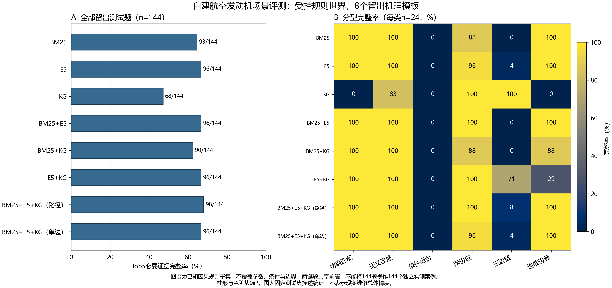

# 自建航空发动机场景评测集：构建与八组消融结果（2026-10-16）

已完成36个虚拟试验台场景、576条独立证据记录、216道问题。开发72题，测试144题，按12个机理词汇模板划分为4个开发模板与8个测试模板。全部指标来自本地BM25、真实中文E5和图谱路径检索运行；本轮零DeepSeek调用，没有改生产检索。

## 构建方式与适用边界

对外名称为“自建航空发动机场景评测集”。方法如实记录：场景模板和生成程序由AI助手协助编写，再以固定种子20261017程序化展开；因果规则、阈值、事件编号和记录是本实验的明确设定，不是实际维修记录或事故调查样本，未逐条获得真实物理实验或专家确认。协议中`model_generated=false`表示没有逐条调用外部生成模型，不表示模板和代码未经AI协助；本说明只澄清元数据语义，未改冻结题目、语料、图或测试。公开教材/报告只提供术语背景，不能作为每条生成规则的实证来源。

每个机理模板生成3个参数化场景，每场景16条记录：3条主链、1条独立监测因果规则、1条采样参数、2条模式条件、1条逆推边界及8条只含界面关键词的干扰记录。存储次序按种子打乱，证据记录本身不改写原有完整句子。每实例六类各1题；两边与三边链共享前缀，实例和题目都不是独立真实案例，统计以机理模板为簇。

本实验的检索单位是独立规则记录；完整场景容器能汇总所有记录，却不作为可检索摘要。该组织方式人为控制了证据分散，不等同“真实资料摘要与所有自然段均无法直接回答”的旧来源认证。多证据链题48道仅指受控记录链，不计入真实来源严格物理多跳题数量。

图由同一语料的主链和监测因果规则子集直接编译，共288个提及、144条规则边；每个边有原记录精确引文。图不覆盖参数、条件和逆推边界记录，因此不能声称所有通道具有相同事实覆盖。这是正确因果结构的辅助上界，不是自动抽取图谱的泛化实验；`certainty=established`只表达场景规则成立，不是现实经验置信度。图来自规则而非题目标签或预测。

按机理词汇模板留出，开发与测试模板无交集；二者共享同一生成器及问题语法。因而这里只考查声明的受控场景迁移，不宣称生成过程完全独立或真实维修外部泛化。独立AI非专家复核216题，通过引文/偏移/摘要边界、必要性、隐藏中间节点与模板隔离检查，没有看预测或选型。审核后的措辞修订仅涉及覆盖与预算说明，原语料/图谱/216题逐字未改，初版保留。

## 比较与冻结

八组：BM25、E5、图谱路径、BM25＋E5、BM25＋图谱、E5＋图谱、路径三路和单边三路。每配置候选请求上限150，单路150、双路各75、三路各50；RRF k=60，融合候选前50，最终前10、每来源最多5记录、4096 tokens。150是截断候选预算，不等于相同实际计算量；复用缓存时间不作为在线延迟。图直接检索有向1至3边路径，无旧关键词门控，这与旧真实资料实验的严格补证包装器不同。

只在72道开发题上比较31个预登记权重配置，全部2232份开发排名保留。按完整@5、完整支持MRR、较低图/向量权重依次选型。测试前冻结了实现、索引、数据、题目与选择结果；测试候选随后单独指纹冻结。单边三路复用路径三路权重，作为匹配权重的结构消融，没有再对测试集单独调优。检索器只接收问题文本及公共活动版本集合，没有任务类别、答案、必要记录、跳数或模板ID输入。

选定权重（顺序B/D/G）：双文本1/2；BM25＋图谱1/0.25；向量＋图谱1/0.25；三路1/2/0.25。该权重只服务本自建集，不推广为生产配置。

指标中的相关记录指有限规则世界里标注的必要证据记录；P@k固定以k为分母，未返回足量时余位为未命中；nDCG使用二值必要记录相关性。首相关MRR与“所有必要记录均出现”的完整支持MRR分开。它们衡量证据可得性，不是回答生成、因果推理正确率或诊断准确率。

## 全量结果

| 方法 | 完整@5 | 完整@10 | 必要记录召回@5 | 必要记录精确@5 | nDCG@5 | 首相关MRR@10 | 完整支持MRR@10 |
|---|---:|---:|---:|---:|---:|---:|---:|
| BM25 | 93/144（64.58%） | 96/144（66.67%） | 82.29% | 24.58% | 0.8078 | 0.8906 | 0.5610 |
| 中文E5 | 96/144（66.67%） | 101/144（70.14%） | 85.30% | 26.25% | 0.8326 | 0.9155 | 0.5443 |
| 图谱路径 | 68/144（47.22%） | 68/144（47.22%） | 47.22% | 19.44% | 0.4697 | 0.4688 | 0.2743 |
| BM25＋中文E5 | 96/144（66.67%） | 98/144（68.06%） | 85.19% | 26.11% | 0.8392 | 0.9225 | 0.5617 |
| BM25＋图谱 | 90/144（62.50%） | 114/144（79.17%） | 82.99% | 25.83% | 0.7653 | 0.8683 | 0.4451 |
| 中文E5＋图谱 | 96/144（66.67%） | 117/144（81.25%） | 78.24% | 26.67% | 0.7492 | 0.8379 | 0.4505 |
| BM25＋中文E5＋路径图谱 | 98/144（68.06%） | 105/144（72.92%） | 86.34% | 26.81% | 0.8367 | 0.9294 | 0.5106 |
| BM25＋中文E5＋单边图谱 | 96/144（66.67%） | 105/144（72.92%） | 86.00% | 26.67% | 0.8260 | 0.9225 | 0.4999 |

主比较在测试前规定为路径三路对双文本的完整@5：98/144对96/144，净增2题，+1.39个百分点；逐题2改善、0退化。按8个机理模板聚类、20000次bootstrap，95%百分位区间为[0.00,+4.17]个百分点，包含零边界，不能据此宣称稳健总体优势，也不把144题视作144个独立样本。

完整@10由98/144到105/144，增加7题（+4.86个百分点）；但E5＋图谱该指标为117/144，高于三路。三路nDCG@5为0.8367，略低于双文本0.8392；完整支持MRR也由0.5617降至0.5106。首相关MRR则由0.9225升至0.9294。不能概括为“三路在所有指标都优于所有双路”。强向量单路的完整@5与双文本同为96/144，亦不能概括为双路总优于任一单路。

## 按类型的完整@5（题数）

| 类型（各24题） | BM25 | E5 | KG | BM25＋E5 | BM25＋KG | E5＋KG | 路径三路 | 单边三路 |
|---|---:|---:|---:|---:|---:|---:|---:|---:|
| 精确匹配 | 24 | 24 | 0 | 24 | 24 | 24 | 24 | 24 |
| 语义改述 | 24 | 24 | 20 | 24 | 24 | 24 | 24 | 24 |
| 条件组合 | 0 | 0 | 0 | 0 | 0 | 0 | 0 | 0 |
| 两边作用链 | 21 | 23 | 24 | 24 | 21 | 24 | 24 | 23 |
| 三边作用链 | 0 | 1 | 24 | 0 | 0 | 17 | 2 | 1 |
| 逆推边界 | 24 | 24 | 0 | 24 | 21 | 7 | 24 | 24 |

图谱单路两边与三边链均24/24，显示规则图已能找齐对应证据；但三路三边链仅2/24，双文本0/24，单边三路1/24。主要问题仍是逐块RRF没有整束保护路径证据，源链中间块在融合中被关键词干扰记录或其他场景挤到后面；本结果不支持路径束融合已充分实现。E5＋图谱三边链17/24，同时逆推边界仅7/24，体现图谱对非正向因果任务的干扰。

条件组合所有方法完整@5/@10均0/24，这个失败类型完整保留。只读核查中，文本通道偏重含“稳态/范围/规定”的触发记录，并召回其他试验台的同模板触发记录，漏掉当前试验台的数值区间记录；尚未通过明确编号实现查询作用域约束，图的因果子集也没有这两类条件事实。该共同题型语法导致明显地板效应，是自建集局限与后续开发方向，不删题重算。

图为固定144题描述统计，各类24题；全部八方法、所有零值均展示，坐标与色阶从0起。依赖结构与推断区间另按模板处理，未添加逐题独立标准误。PNG 4200×1980、300dpi，并提供可编辑SVG和原始图数据；尚未指定期刊，未声称满足特定投稿规格。

## 论文方法与结果表述草稿

为分析检索通道在不同任务上的互补性，本研究自主构建航空发动机试验台场景评测集。通过程序化规则建立故障状态、连续作用关系、适用条件及干扰记录，并从这些记录构造问题和参考证据。数据按机理模板划分开发集与测试集，图谱由其中的因果规则直接编译，实验旨在衡量正确关系结构下的证据检索能力，不包含真实文档自动抽取误差。

在144道受控留出测试题上，BM25、中文向量、双文本与路径三路的Top5必要证据完整率分别为64.58%、66.67%、66.67%与68.06%。三路对双文本提高1.39个百分点，收益集中于多证据链任务；然而排序指标并未全面改善，条件组合与长路径融合仍存在不足。该结果支持进一步研究按任务和路径整束组织的融合方法，其适用范围限于本文定义的自建场景。

## 验证、复现与留存

1152份测试排名逐行重算必要记录召回、精确、完整率与nDCG，4个独立解析数值例验证首相关/完整支持MRR、空结果和截断边界。576个真实E5中文向量逐条独立复算，384维，最大误差0；向量/词法原文身份一致，索引未变。新脚本Ruff通过。旧三轮283/299/276项冻结输入逐项未变，本轮测试冻结与候选指纹亦全部保持。

本轮零外部模型调用；生产仍为BM25＋中文E5，未上线自建规则图。绘图库安装在单独环境，不改冻结检索环境。测试结果已经可见，后续只能把本测试作为开发/回归；不得改题、删零分类型或修改权重后继续称同一独立测试。

- 数据：`evaluation/controlled_scenario_v1/README.md`、`protocol.json`、`corpus.json`、`graph.json`、两份`questions-*.jsonl`。
- 实验：`.runtime/controlled-scenario-v1/`中的`strategy-freeze.json`、`test-freeze.json`、`test-summary.json`、`primary-comparison.json`、完整开发/测试排名与候选指纹、独立数据和向量审核。
- 生成与评测代码：`scripts/controlled_scenario_benchmark_v1.py`，阶段为prepare/build/cache-dev/develop/freeze/cache-test/evaluate/audit。原目录禁止覆盖；完整重现时复制脚本并将DATA/OUT改为两个新的空目录，保持种子与规则不变，先进行独立复核。
- 图：`figures/controlled-scenario-v1/`内PNG/SVG、数据、图源、环境版本与可复现绘图脚本。

共享研究账本当前保守占用41.433678/42元，剩0.566322元；本轮没有新增DeepSeek费用，历史未知预留仍按原账本计入。
