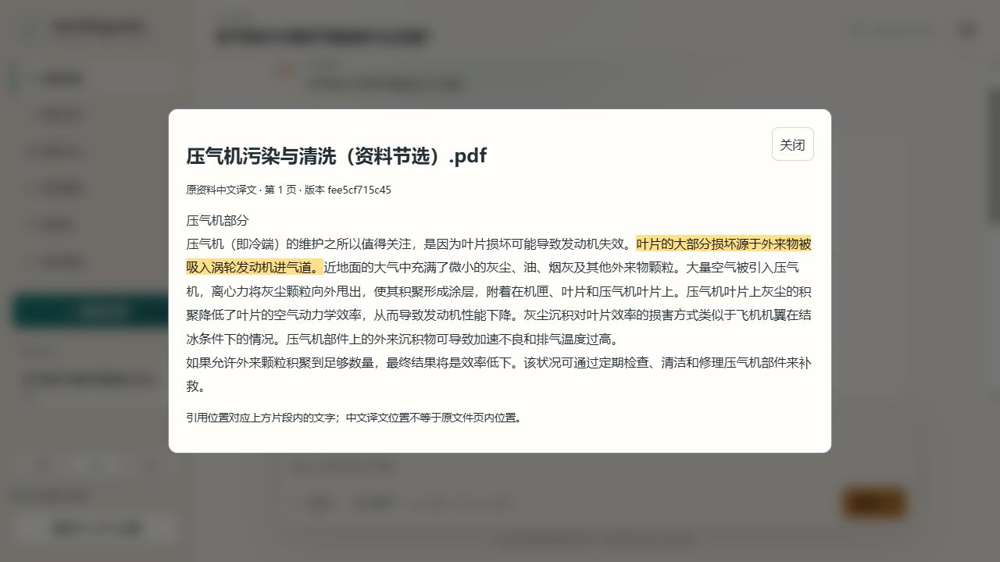

# 门控三路接入实际知识问答与端到端验收（2026-10-16）

首页知识问答已使用来源约束与路径可信度门控的BM25、中文E5、图谱三路RRF。实际本机地址为 http://127.0.0.1:8082/ 。旧多工具诊断API和交互根因分析模块继续保留；本轮没有导入自建规则数据到实际知识库，也没有改写已有图谱。

## 已完成的功能

1. 活动资料版本、指定文档和适用条件在检索前筛选；问题明确编号按原冻结规则进一步约束来源。B/D/G各最多50候选，权重1/0.25/0.25，RRF常数60；候选池50、最多10条证据、每文档5条、检索正文4096个E5计数token。
2. 图谱发现与验证共用请求内快照，校验边方向、来源引用、实体连接、2—3边完整路径及关系适用范围。没有合格路径或图谱不可用时回退50＋50文本检索，不为了展示而放宽门控。门控仍是查询级开关，不宣称对所有入池图谱候选逐项认证。
3. 回答先生成带片段选择器的原子陈述，再校验实际引用、偏移、哈希与不确定性，并用模型检查支持性和问题覆盖。引用元数据由程序复制，模型不能自定原文或偏移。任何必要检查失败，不展示未经核实的结论。模型复核并非独立专家验证，仍可能漏检语义错误。
4. 回答引用可点击查看资料片段，显示中文译文、PDF页码（存在时）和版本，并高亮准确引用。中文译文内的偏移不等于原文件页内坐标；本轮查看的是已解析资料片段，不是PDF整页渲染。已有原文件下载继续保留原操作员权限要求。
5. 只展示本次证据中支持片段齐全且通过来源校验的图谱路径，展示节点、中文关系和各支持片段入口。额外记录路径是否真正进入生成模型上下文，避免把检索发现等同于模型使用。路径不完整时明确提示，不拼造中间关系。
6. 证据不足、模型不可用、上下文装不下、引用失败及问题覆盖失败均明确说明。没有模型时仍可查看证据，但不把摘录称为已验证回答。模型声明不足时可保留已支持的部分事实，同时保留缺失说明。
7. 问答与证据保存至既有会话，刷新后恢复；读取片段时只允许活动版本。回答生成期间资料更新或译文变化会要求重试。前端引用、路径和来源文本均转义，引用高亮按Unicode码点定位。

## 工程验收结果

| 检查 | 结果 | 能支持的结论 |
|---|---|---|
| 新旧路径、问答、HTTP与模型接口回归 | 69通过 | 功能与失败分支行为符合约定 |
| 全源Mypy | 121文件通过 | 静态类型检查通过 |
| Ruff、两份前端行为测试与JS语法 | 通过 | 载荷兼容、引用/路径/拒答渲染与转义通过 |
| 新运行时复放原冻结216题 | Top10逐题完全一致 | 接入没有改变已报告的门控排序 |
| 复放图谱参与与完整路径 | 72题启用，72题含完整展示路径；144题回退 | 自建规则场景的路径保留与展示条件正确 |
| 完整路径HTTP分支 | 通过 | 临时隔离测试库的路径来源可逐条查看 |
| 实际本机资料＋中文E5＋Neo4j | 已连通 | 真实配置可检索、可门控和回退 |

216题复放复用冻结BM25/E5候选，在新运行时执行图谱发现和门控融合；这不是重跑嵌入或新独立测试。完整路径HTTP验收使用规则构造资料和隔离的图谱通道分支，未改实际知识库；它不是实际资料多跳效果的证明。实际压气机问题没有找到合格完整路径，正确回退文本。

## 实际公开资料问答验收

追加付费验收限定到公开FAA教材摘录 `prebuilt-compressor-cleaning`，来源为 `https://www.faa.gov/sites/faa.gov/files/12_amtp_ch10_0.pdf`。脚本先以不调用模型的请求核验每条返回证据的文档与来源URL，再执行模型请求。测试问题与预期先保存，未按结果改题。原先全库付费验收被自动审批拦截，理由是可能发送内部资料；缩小为核实的公开FAA来源后获准完成，没有绕过原限制。

| 用例 | 实际表现 | 模型调用 | 引用逐字、偏移与哈希核验 |
|---|---|---:|---:|
| 压气机叶片损坏可能由什么引起 | 回答证据支持的外来物吸入等事实 | 2 | 5条通过 |
| 仅凭排气温度升高是否一定能确定叶片损坏 | 明确证据不足；保留4条有来源支持的背景事实，不确定根因 | 2 | 4条通过 |
| 未知QB-99999999编号 | 无证据、明确不足 | 0 | 无引用 |
| 指定不存在的资料 | 无证据、明确不足 | 0 | 无引用 |

两项公开资料模型用例分别约2.92秒和2.53秒；两项空来源约0.027秒和0.007秒，仅为本机4例实测，不代表总体时延或统计性能。另完成一次首页实际模型问答与引用高亮检查，刷新历史可恢复。以上属于工程冒烟验收，不计算回答准确率或独立测试显著性；下一阶段若评估生成质量，需要冻结未见真实来源题并独立审核。

## 接口与代码

* `POST /api/qa/answer`：问题、可选会话、knowledge_context、可选provider；`evidence_only:true`不调用模型。
* `GET /api/qa/evidence/{chunk_id}`：活动版本片段、显示文本哈希、定位和中文译文标记。
* `src/aerodiagnosis/application/knowledge_qa_live.py`：门控融合、完整路径展示条件与回答校验。
* `src/aerodiagnosis/adapters/api/qa.py`：活动资料、模型预算和HTTP/会话接入。
* `src/aerodiagnosis/adapters/web/static/grounded-qa.{js,css}`：引用、原文弹窗与路径展示。
* `tests/unit/test_live_qa.py`、`frontend_grounded_qa.cjs`：功能与转义验收。

本机启动沿用 `scripts/start_local_neo4j.ps1` 和 `scripts/start_chinese_hybrid.ps1`。保留已授权的42元累计上限；研究配置中所有新问答模型调用使用共享账本且硬限不超过42元，账本未重置。API密钥不进入问答会话或验收材料。

## 冻结历史与费用

旧实验数据、候选、索引与逐题预测保持不变。为接入实际应用而修改的旧运行时代码，已先保存逐字原件至 `.runtime/qa-integration-v1/frozen-source-backup/`，核对各历史冻结清单时可使用该原件；不能再宣称当前运行时代码本身与所有历史源码哈希相同。审计清单区分“当前文件未变”和“冻结原件保留”。后续复现旧实验应在独立副本恢复原件，勿覆盖运行中的新问答代码。

本轮实际新增6次模型请求，保守新增0.043670元；累计41.477348/42元，剩0.522652元。历史15次未知收费预留仍计入，无本轮待决请求、无后台付费任务。

原始验收、复放结果、脚本、截图和哈希清单位于同名附件目录 `live-gated-qa-v1-2026-10-16/`。下一阶段应扩展真实来源端到端题目与独立语义复核；本轮不以模型自审或自建题满分宣称真实发动机诊断准确率。
