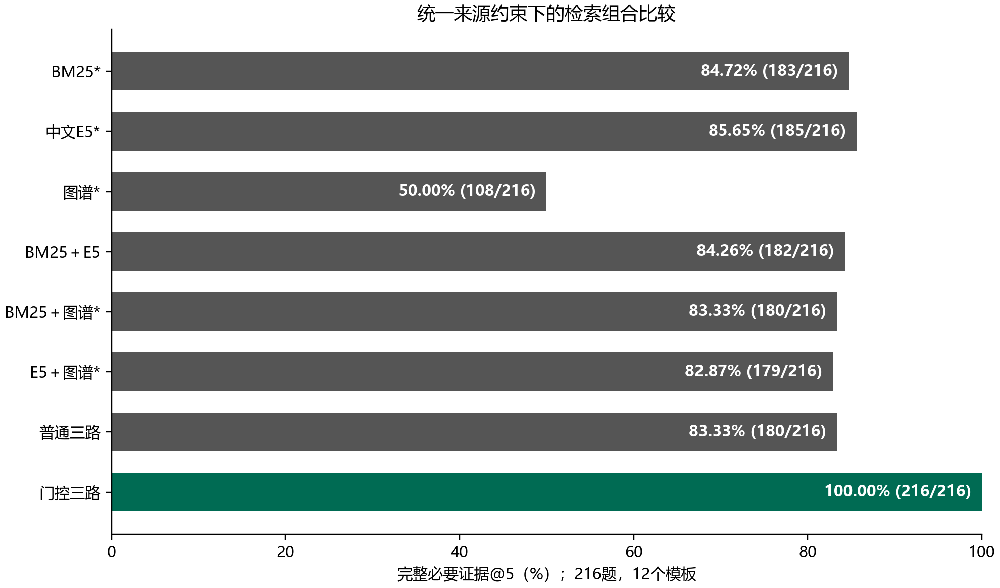
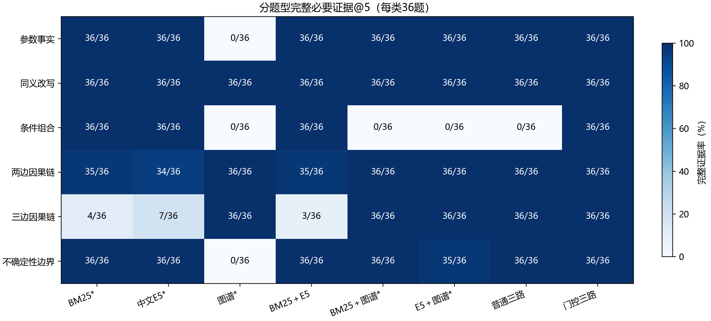

# 门控三路检索的实验设计、对比与分析

以下正文可作为论文章节草稿。实验最终方案为“来源约束与路径可信度门控的BM25、中文E5和图谱三路融合”。最终方案是在本轮v2测试结果可见后确定的；参数在测试前已冻结，但方案选择本身不是预先确认性结论。本轮不重跑模型、不修改问题或参考证据。

## 1 研究问题与实验设置

本实验研究三类信息是否具有互补性：BM25提供词项匹配，中文E5提供语义匹配，图谱提供有向因果路径及其来源证据。研究问题包括：（1）增加检索通道是否必然提高效果；（2）图谱对不同题型的贡献是否不同；（3）来源约束、门控和路径保留分别产生何种影响。评价对象为检索证据，不涉及生成答案正确率、现场诊断准确率或Neo4j运行性能。

采用自建航空发动机场景评测集。数据由AI辅助设计机理词汇模板并程序化扩展为虚拟试验台规则场景，不属于现场实测维修数据；图谱由其中明确因果记录子集编译，构成已知规则结构下的能力验证，不能替代自动抽取质量评价。旧v1全部216题用于开发，59配置共12,744条排名完成调参；冻结后构造12个新机理词汇模板、36场景、576条证据、216道测试题。新旧共享生成语法；12个模板是统计聚类单位，不能把216题视为相互独立真实案例。每类36题，分别为参数事实、同义改写、条件组合、两边因果链、三边因果链、不确定性边界。独立AI非专家在测试排名前复核全部问题与来源，未由行业专家标注。

所有方法总候选上限150：单路150、双路每路75、三路每路50；融合候选池50，返回最多10条，上下文最多4096 token，每文档最多5条。采用既有来源去重规则。由于不同组合会改变各路候选配额，组合消融同时包含候选分配差异，不是严格固定候选集合下的独立因子效应。来源约束仅依赖题面试验台编号，在各通道检索之前限定活动资料版本；未知编号不扩展为全库匹配。该约束依赖本数据集显式编号设定。

加权倒数排名融合为 `score(d)=Σ[w_c/(60+rank_c(d))]`。原全局三路权重B:D:G=1:2:0.25；最终门控三路权重为1:0.25:0.25，来源约束双文本为1:0.25，独立调优来源约束三路为1:2:0.25。权重来自旧开发题，未在新题上重选。单路权重不影响排序。

最终方案先执行来源约束，再检查查询因果意图和候选图谱路径：需存在2—3条明确肯定的因果边、方向连续、端点与问题匹配、来源及逐字引用有效，且所需路径证据均在图谱候选配额内；不接受逆向归因和不确定性边界推断。有合格路径时采用普通三路RRF，否则回退至三路配额下的50＋50文本基线。这里是查询级开关：有一条路径合格并不代表逐一过滤并认证所有入池图谱候选。当前受控场景为72题开图谱、144题回退：两种因果链各36题启用图谱，其余4类全部回退。门控只读取问题与候选路径，不读取参考答案或题型标签。

## 2 指标定义与报告口径

令必要证据集合为S，前K条检索结果为R_K。完整证据率Complete@K为`I(S⊆R_K)`的题均值；Recall@K为`|S∩R_K|/|S|`，Precision@K为`|S∩R_K|/K`，分母固定K，即使结果不足K条也不改变。nDCG使用二元相关性；MRR反映首条相关证据出现位置，完整MRR反映全部必要证据首次齐全位置。主指标为完整@5，同时保留完整@3、@10和排序指标，避免只展示单一有利结果。多证据题完整@1具有结构上限，详表仍提供全部K值。

## 3 单路、双路与三路总体比较

### 3.1 全库检索组合（相同总候选上限）

| 方法 | 完整@3 | 完整@5 | 完整@10 | Recall@5 | Precision@5 | nDCG@5 | MRR | 完整MRR |
|---|---:|---:|---:|---:|---:|---:|---:|---:|
| BM25 | 132/216 | 146/216 | 147/216 | 0.8194 | 0.2407 | 0.7989 | 0.8681 | 0.5701 |
| 中文E5 | 159/216 | 170/216 | 179/216 | 0.9005 | 0.2796 | 0.8691 | 0.9091 | 0.6119 |
| 图谱路径 | 96/216 | 96/216 | 96/216 | 0.4444 | 0.1889 | 0.4427 | 0.4421 | 0.2477 |
| BM25＋E5 | 150/216 | 156/216 | 170/216 | 0.8719 | 0.2676 | 0.8493 | 0.9016 | 0.6018 |
| BM25＋图谱* | 101/216 | 127/216 | 182/216 | 0.7585 | 0.2509 | 0.7101 | 0.8179 | 0.4250 |
| E5＋图谱* | 147/216 | 187/216 | 198/216 | 0.9398 | 0.3056 | 0.8210 | 0.8308 | 0.4900 |
| 普通三路 | 152/216 | 161/216 | 183/216 | 0.8974 | 0.2824 | 0.8286 | 0.8816 | 0.5067 |

带*方法是测试可见后的补充描述性消融，直接继承冻结全局权重并删除其余通道，不重新调参。保留这一层完整七组合，避免把来源约束带来的收益混入“通道数收益”。

### 3.2 统一来源约束下的完整七组合及最终方案

| 方法 | 完整@3 | 完整@5 | 完整@10 | Recall@5 | Precision@5 | nDCG@5 | MRR | 完整MRR |
|---|---:|---:|---:|---:|---:|---:|---:|---:|
| 来源约束BM25* | 162/216 | 183/216 | 183/216 | 0.9483 | 0.3028 | 0.8926 | 0.8912 | 0.6353 |
| 来源约束E5* | 175/216 | 185/216 | 185/216 | 0.9367 | 0.2963 | 0.9019 | 0.9124 | 0.6449 |
| 来源约束图谱* | 108/216 | 108/216 | 108/216 | 0.5000 | 0.2000 | 0.4983 | 0.4977 | 0.3032 |
| 来源约束BM25＋E5 | 164/216 | 182/216 | 182/216 | 0.9468 | 0.3019 | 0.8947 | 0.8958 | 0.6356 |
| 来源约束BM25＋图谱* | 104/216 | 180/216 | 180/216 | 0.9167 | 0.3000 | 0.6492 | 0.5792 | 0.3514 |
| 来源约束E5＋图谱* | 108/216 | 179/216 | 179/216 | 0.9120 | 0.2991 | 0.6648 | 0.5991 | 0.3674 |
| 匹配权重普通三路 | 107/216 | 180/216 | 180/216 | 0.9167 | 0.3000 | 0.6532 | 0.5843 | 0.3553 |
| 门控三路（最终实验方案） | 215/216 | 216/216 | 216/216 | 1.0000 | 0.3333 | 0.9843 | 0.9838 | 0.7049 |

该层补充方法沿用最终权重B:D:G=1:0.25:0.25。它们未分别重新优化，不能称为每种组合的最优性能；单路来源约束对照尤其用于检查增益是否来自图谱之外的来源筛选。最终门控方案保留全部冻结参数。

## 4 分题型结果

每类36题。下表比较来源约束下的各组合，完整指标附于JSONL详表。

| 题型 | B* | D* | G* | BD | BG* | DG* | 普通三路 | 门控三路 |
|---|---:|---:|---:|---:|---:|---:|---:|---:|
| 参数事实 | 36/36 | 36/36 | 0/36 | 36/36 | 36/36 | 36/36 | 36/36 | 36/36 |
| 同义改写 | 36/36 | 36/36 | 36/36 | 36/36 | 36/36 | 36/36 | 36/36 | 36/36 |
| 条件组合 | 36/36 | 36/36 | 0/36 | 36/36 | 0/36 | 0/36 | 0/36 | 36/36 |
| 两边因果链 | 35/36 | 34/36 | 36/36 | 35/36 | 36/36 | 36/36 | 36/36 | 36/36 |
| 三边因果链 | 4/36 | 7/36 | 36/36 | 3/36 | 36/36 | 36/36 | 36/36 | 36/36 |
| 不确定性边界 | 36/36 | 36/36 | 0/36 | 36/36 | 36/36 | 35/36 | 36/36 | 36/36 |

门控三路分型排序与召回指标如下。

| 题型 | 完整@3 | 完整@5 | Recall@5 | Precision@5 | nDCG@5 | MRR | 完整MRR |
|---|---:|---:|---:|---:|---:|---:|---:|
| 参数事实 | 36/36 | 36/36 | 1.0000 | 0.2000 | 1.0000 | 1.0000 | 1.0000 |
| 同义改写 | 36/36 | 36/36 | 1.0000 | 0.2000 | 1.0000 | 1.0000 | 1.0000 |
| 条件组合 | 36/36 | 36/36 | 1.0000 | 0.4000 | 1.0000 | 1.0000 | 0.5000 |
| 两边因果链 | 36/36 | 36/36 | 1.0000 | 0.4000 | 0.9069 | 0.9028 | 0.3981 |
| 三边因果链 | 35/36 | 36/36 | 1.0000 | 0.6000 | 0.9991 | 1.0000 | 0.3310 |
| 不确定性边界 | 36/36 | 36/36 | 1.0000 | 0.2000 | 1.0000 | 1.0000 | 1.0000 |

来源约束的向量单路185/216略高于双文本182/216；全局E5＋图谱187/216也高于普通三路161/216。结果不支持单路＜双路＜三路的普遍单调关系。最终门控三路的意义在于依问题适用性结合文本覆盖与因果路径补证，而非通道数量本身。

## 5 消融与机制分析

| 方法 | 完整@3 | 完整@5 | 完整@10 | Recall@5 | Precision@5 | nDCG@5 | MRR | 完整MRR |
|---|---:|---:|---:|---:|---:|---:|---:|---:|
| BM25＋E5 | 150/216 | 156/216 | 170/216 | 0.8719 | 0.2676 | 0.8493 | 0.9016 | 0.6018 |
| 来源约束BM25＋E5 | 164/216 | 182/216 | 182/216 | 0.9468 | 0.3019 | 0.8947 | 0.8958 | 0.6356 |
| 普通三路 | 152/216 | 161/216 | 183/216 | 0.8974 | 0.2824 | 0.8286 | 0.8816 | 0.5067 |
| 独立调优三路 | 148/216 | 208/216 | 208/216 | 0.9846 | 0.3259 | 0.7595 | 0.6884 | 0.4471 |
| 匹配权重普通三路 | 107/216 | 180/216 | 180/216 | 0.9167 | 0.3000 | 0.6532 | 0.5843 | 0.3553 |
| 单边图谱三路 | 107/216 | 180/216 | 180/216 | 0.9167 | 0.3000 | 0.6518 | 0.5819 | 0.3546 |
| 门控三路（最终实验方案） | 215/216 | 216/216 | 216/216 | 1.0000 | 0.3333 | 0.9843 | 0.9838 | 0.7049 |
| 全局文本＋完整路径 | 156/216 | 193/216 | 205/216 | 0.9468 | 0.3120 | 0.9119 | 0.9144 | 0.6587 |
| 来源约束完整路径三路 | 184/216 | 216/216 | 216/216 | 1.0000 | 0.3333 | 0.9434 | 0.8981 | 0.7006 |

**来源约束。** 双文本完整@5由156/216提高至182/216，净增26题（12.04个百分点）；这一收益不依赖图谱，不能归因于知识图谱。由于权重也由1:2变为1:0.25，这是两种已选配置的对比，不是只改变来源筛选的纯消融。严格固定权重的对照应使用随附配置说明及后续新开发研究，不能据此拆出单一因果贡献。

**门控。** 在来源约束与相同1:0.25:0.25权重下，普通三路完整@5为180/216，门控三路为216/216；这组对比共享三路候选配额和融合规则，主要差异是图谱不适用时回退文本。由此表明，对所有题无差别加入图谱会引入排序干扰。这36题改善全部来自条件组合题，说明此处门控的作用是避免图谱干扰，而不是新增图谱证据。

**多跳补证。** 对来源约束双文本，门控三路完整@5改善34题、退化0题，其中两边链改善1题、三边链改善33题；其他四类完整率保持不变。三边链由3/36增至36/36；这是图谱作用最清晰的受控场景证据。不应推出所有多跳问题图谱均占优。

**图谱覆盖。** 图谱只包含因果记录子集；参数、条件与边界知识主要由文本承载。图谱单路的低总体结果同时受覆盖范围影响，不能简单解释为图算法能力较弱。增加通道不保证效果单调：最终判断必须同时检查题型、完整证据率和排序指标。

**路径与单边。** 同权重单边三路180/216，普通路径三路同为180/216；仅增加路径召回而缺少门控，没有提高整体完整@5。两者排序指标的微小差异完整保留。

**完整路径插入。** 门控RRF与完整路径三路均216/216，但前者完整@3为215/216，后者184/216；nDCG@5分别0.9843和0.9434，MRR分别0.9838和0.8981。路径原子插入解决了保留完整性的工程约束，却不等同于更好排序。因此确定门控RRF为最终实验方案，整束插入作为消融和可选保障保留。

## 6 配对比较、统计与选择边界

原冻结协议预先指定的是完整路径方法对来源约束双文本以及匹配门控三路的总体/三边链4个完整@5对比，并采用12模板聚类bootstrap（20,000次）及精确2^12符号翻转检验、Holm四项校正。原结果保留：完整路径对双文本总体差15.74个百分点，95%区间[13.89,17.59]，校正p=0.001953；三边链差91.67个百分点，区间[83.33,100]；对门控三路完整@5差0，p=1。门控与完整路径的逐题完整@5一致，因此描述性差值与区间数值相同，但不得把原协议重新包装成“预登记检验了最终选择的门控方案”。本次补充组合只报告描述性比较，不新增挑选显著性的检验。

本轮最终方案选择参考了新测试排序结果，故v2可用于报告已冻结配置的比较，但不是最终方案选择后再进行的一次全新确认性测试。满分存在天花板效应，不能据此声称两种方法等效、无差异或真实系统已达100%准确率。共享模板与生成语法、已知规则图、明确试验台编号、AI非专家复核、机理知识覆盖受限均限制外推。真实来源试验此前未显示稳定图谱整体优势，应与本受控能力实验分别陈述，不能合并计算总体提升。

## 7 可直接用于论文的结果分析段落

在自建航空发动机场景评测集上，来源约束的BM25与中文E5双路检索在前5条结果中完整覆盖必要证据的比例为84.26%（182/216）。引入因果意图与路径可信度门控后，三路融合完整证据率达到100.00%（216/216），提高15.74个百分点。分题型比较发现，改善集中在多跳因果问题：两边链由35/36提升至36/36，三边链由3/36提升至36/36；事实查询、同义改写、条件组合与不确定性边界问题的完整证据率保持不变。结果说明，在本实验的规则构造场景中，图谱可通过显式关系补充文本检索未同时保留的链式证据。

消融结果同时表明，三路组合的优势并非来自通道数量本身。匹配权重但取消门控的三路融合仅获得83.33%的完整证据率（180/216），低于来源约束双文本；门控通过对不适用问题回退文本，减少了图谱候选对原有证据排序的干扰。完整路径原子插入虽同样获得全部必要证据，但nDCG@5低于门控RRF（0.9434对0.9843）。因此，本研究选择来源约束与路径可信度门控的三路RRF作为最终实验方案，保留完整路径插入作为工程保障选项。上述结论适用于程序化构造的自建场景及规则编译图谱，不作为真实发动机诊断准确率或自动建图质量的证明。

## 8 可复现材料

本目录保存补充方案声明、1512条补充预测、19方法×7分组汇总、逐题配对胜负、门控激活表和全部指标长表；原12组2592条冻结预测保持不变，合计4104条。补充方法7组×216题，仅复用本地候选，不调用DeepSeek。研究累计预算维持41.433678/42元。生产默认BM25＋中文E5未修改。

* `all-method-summary.json`：19种配置的全部总体/分型指标。
* `metrics-long.jsonl`：含@1/@3/@5/@10的完整机器可读指标。
* `supplement-protocol.json`、`supplement-predictions.jsonl`：补充消融说明与逐题排名。
* `paired-descriptive.json`、`gate-activation.json`：改善/退化及参与统计。
* `analysis-audit.json`、`artifact-manifest.json`：指标与输入哈希校验。
* `paper_gated_analysis.py`：本地复算与正文生成脚本。

## 9 论文插图

图1：七种检索通道组合与最终门控方案，均使用来源约束。标*为补充描述性消融。图中为本批216题经验比例，无独立样本误差条。表中保留全部19种配置。

图2：每格给出完整必要证据题数/36，色阶统一0—100%。条件题取消门控后的失败与多跳题文本不足均保留。原始数值见all-method-summary.json。图为论文草稿配图，未按特定期刊版式认证。

复算命令（在项目集成工作区运行）：`.venv/Scripts/python.exe -X utf8 docs/upgrade/execution/gated-triple-paper-2026-10-16/paper_gated_analysis.py`。绘图脚本需包含Matplotlib与NumPy的Python环境。
